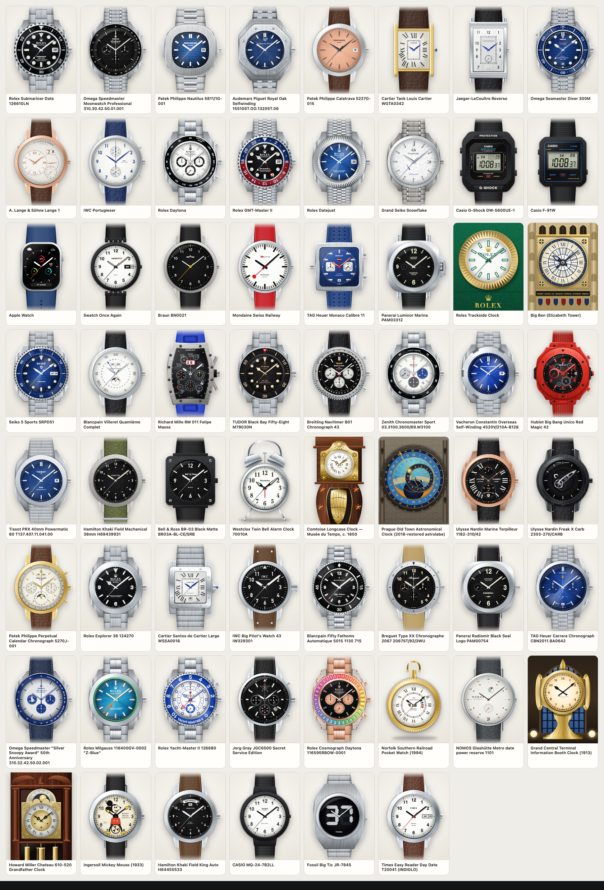
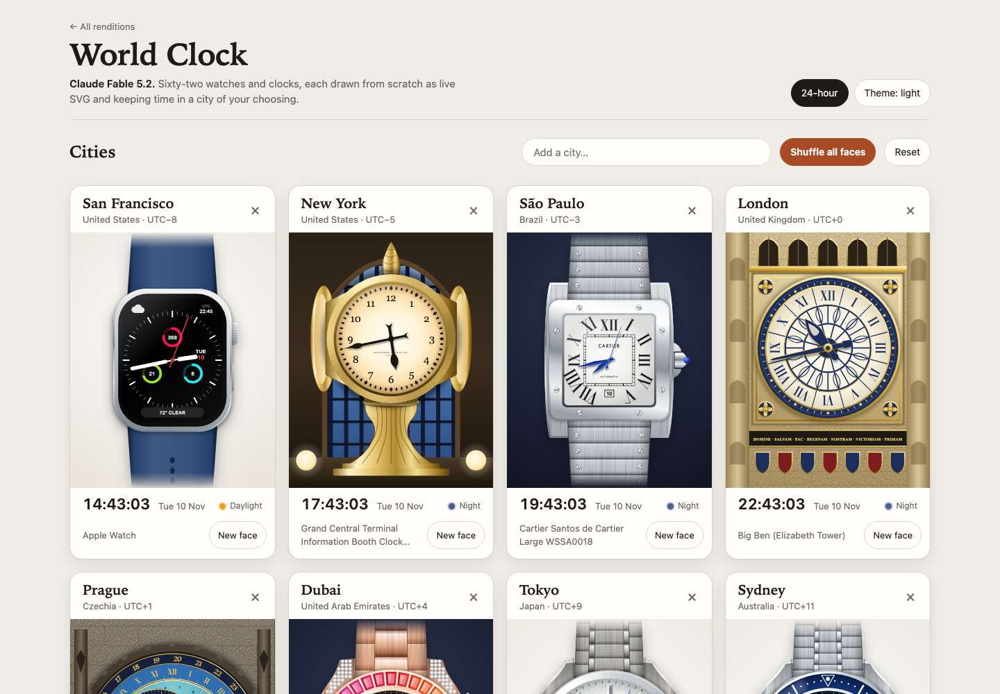

# Claude Fable 5.2: reference and rendering notes

This rendition is a new standalone page, [`versions/fable-5.2.html`](../versions/fable-5.2.html). It was written from scratch for this entry: its own time engine, SVG drawing kit, interface and all 62 faces. It does not copy, extend or adapt any other model's page. No photographs are embedded; every timepiece is drawn as inline SVG when the page loads.

## The page

- **Cities.** The atlas has 136 cities. Search by city, country or zone name; arrow keys and Enter work in the suggestion list. Cards can be removed or given a new face, **Shuffle all faces** deals a distinct face to every city, and **Reset** restores the eight starting cities. Settings are saved in the browser's local storage. Cards are ordered by current UTC offset, west to east, with an alphabetical tie-break.
- **Sky.** Each card shows Daylight, Sunrise, Sunset, Dawn, Dusk or Night from the sun's elevation at that city, and tints the backdrop behind the watch to match.
- **Collection and inspection.** All 62 pieces run on local time in the collection, which can be filtered by group or searched. Opening a piece shows it large with its movement and notes. It can be posed at fixed times, at a month end, or at the next full moon, shown in any city on the board, and assigned to that city. `#piece=<key>` in the address opens a piece directly.
- **Chronographs.** Fifteen pieces have working chronographs in the inspector, with start, stop and reset.
- **Time.** Local time comes from the browser's `Intl` time-zone data. Each face moves at its catalog cadence:
  - `sweep`: the seconds hand steps at the calibre's beat rate, from 21,600 to 36,000 vph.
  - `tick`: quartz watches and clocks step once a second.
  - `glide`: the Spring Drive and the Apple Watch move continuously.
  - `digital`: every LCD segment is drawn and switched individually.
  - `mondaine`: a 58.5-second sweep, a pause at twelve, and a jumping minute hand.
  - With `prefers-reduced-motion`, sweeping and gliding hands step once a second and pendulums rest.
- **Drawing.** Each face is two stacked SVG layers: the object itself, and the moving parts with the crystal above them. Hands cast one soft shadow in screen space, so the shadow does not turn with the hand. Brushed metal, grained dials, leather and the Snowflake texture are SVG turbulence and lighting filters; sunray dials are fans of fine wedges.

[Phone width](assets/fable-5.2-mobile.png) · [Inspection view](assets/fable-5.2-inspection.png)

## References

The supplied photo archive has images for 35 of the 62 catalog objects. Each of those was drawn against its photographs, then rendered side by side with one of them in two full rounds, the second zoomed to the dial. The drawing was corrected wherever the two disagreed:

`submariner`, `speedmaster`, `nautilus`, `royaloak`, `seamaster`, `daytona`, `gmt`, `datejust`, `snowflake`, `f1`, `seiko5`, `richardmille`, `blackbay58`, `navitimer`, `overseas`, `bigbang`, `twinbell`, `orloj`, `marine`, `freak`, `patek`, `explorer`, `santos`, `bigpilot`, `typexx`, `carrera`, `snoopy`, `milgauss`, `yachtmaster2`, `jorggray`, `rainbow`, `nomosmetro`, `grandcentral`, `howardmiller` and `mickey`.

What the comparisons changed:

- **Steel.** Brushed cases and bracelets were too pale and polished bezels too flat. Both were retoned against the photographs.
- **Lugs.** The Speedmaster, Seamaster and Snowflake have slender lugs, not the broad Oyster shoulders they first shared.
- **Bezel and dial proportions.** The Snowflake, Explorer, Type XX and twin-bell clock had bezels that were too wide and dials that were too small.
- **Lettering and furniture.** Larger bezel numerals on the GMT-Master II, Yacht-Master II, Daytona and Black Bay; larger Roman numerals and counters on the Marine Torpilleur; a bolder slide rule and larger counters on the Navitimer; larger counters and date ring on the Patek; a squarer bezel and heavier numerals on the Santos.
- **Dive-bezel numerals.** Rolex, Tudor, Seiko and Blancpain set every numeral with its top outward except an upright 30. The Seamaster 300M and the GMT-Master II turn every numeral outward, so 30 and 12 read inverted at six o'clock.
- **Second round.**
  - Patek 5270J: the day and month discs are light with black print.
  - Milgauss: a larger dial inside a slimmer bezel, with the orange five-minute numerals in the minute track.
  - Santos: narrower case flanks, smaller numerals and a larger railway square.
  - Carrera: larger counters, a 12-hour counter marked 4, 8 and 12, an open running-seconds hand, and the date at six between HEUER 02 and 80 HOURS.
  - Type XX: the numeral 5 is present, with the date tucked between 4 and 5.
  - Twin-bell clock: the red alarm pointer, which an earlier build drew outside the frame.
  - Big Pilot: a larger signature, and clear space around the two dots beside the triangle.
  - Seiko 5: the arrow-headed minute hand.
  - Seamaster: a deeper navy bezel.
  - NOMOS Metro: wire lugs standing clear of the strap.

The other 27 folders are empty. For all 27, public product and auction photographs were looked up, and the drawing was checked against them:

- `lange1`, `calatrava`, `tank`, `reverso`, `portugieser`, `moonphase`, `elprimero`, `monaco`, `panerai`, `radiomir`, `fiftyfathoms`, `br03`, `prx`, `khaki`, `kingkhaki`, `apple`, `braun`, `swatch`, `mondaine`, `gshock`, `f91w`, `casiomq24`, `timexindiglo`, `bigtic`, `railroad`, `bigben` and `grandfather`.

Those lookups corrected several faces that had first been drawn from description:

- **Villeret.** The 31-day ring sits inside the Roman hour numerals, not outside them.
- **Monaco.** Red hour and minute hands and a round minute track with luminous dots.
- **Luminor Marina.** A numeral 9 beside the small seconds, the name on two lines, green-toned lume and the black rubber strap of PAM03312.
- **Radiomir.** Steel hands, PANERAI above the OP mark, and a black strap.
- **Chronomaster Sport.** The bezel counts 10 to 90 with its lettering across the top.
- **Fifty Fathoms.** An upright 30 on the bezel, a script signature and the depth rating.
- **BR 03.** The mixed-case signature and the BR 03-A model line.
- **Swatch.** Luminous black hands, a black seconds hand and a white-on-black day.
- **Apple Watch.** Redrawn as the watchOS Activity Analog face: Move, Exercise and Stand each have their own ring, with the day and date at three and complications in the corners.
- **Khaki Field King.** Photographs of H64455533 confirmed the arched full-day window at twelve with the date below it, so the drawing stands.

For four photographed pieces the supplied photographs show a different reference from the one the catalog names. The photographs gave the case and layout, the catalog reference was looked up, and that is what is drawn:

- **Nautilus 5811/1G-001.** White gold, with a blue sunburst dial that shades to black and broad horizontal embossing. The supplied photographs show the Tiffany-dial 5711.
- **Marine Torpilleur 1182-310/42.** Rose gold, black dial, white Roman numerals, gold hands and a black strap. The supplied photographs show the white-dial steel model on a bracelet.
- **Big Bang Unico Red Magic 42.** Red ceramic with red numerals and hand inserts, black screws and a red lined strap. The supplied photographs show other colourways.
- **Howard Miller Chateau 610-520.** A silver chapter ring of Roman numerals around a plain brass centre, scrolled corner spandrels and the moon arch. The supplied photographs show several other Howard Miller dials, with Arabic numerals.

## Variant choices

Every face keeps its catalog name and cadence. Where the catalog names a family and not one reference, this is what is drawn. The inspector states the drawn reference.

| Key | Catalog label | Drawn as |
| --- | --- | --- |
| `gmt` | GMT-Master II | 126710BLRO “Pepsi” on a Jubilee bracelet. |
| `datejust` | Datejust | Datejust 41 126334: bright blue dial, fluted bezel, Jubilee. |
| `daytona` | Daytona | 126500LN with the white dial. |
| `seamaster` | Seamaster Diver 300M | 210.30.42.20.03.001, blue ceramic wave dial. |
| `snowflake` | Grand Seiko Snowflake | SBGA211. |
| `lange1` | Lange 1 | 191.032, pink gold with argenté dial. |
| `portugieser` | IWC Portugieser | Portugieser Chronograph IW371605. |
| `reverso` | Jaeger-LeCoultre Reverso | Reverso Classic Monoface Small Seconds. |
| `moonphase` | Villeret Quantième Complet | 6654 in steel with a white dial. |
| `navitimer` | B01 Chronograph 43 | AB0138211B1P1: black dial, silver counters, alligator strap. |
| `monaco` | Monaco Calibre 11 | CAW211P, blue dial. |
| `richardmille` | RM 011 Felipe Massa | The titanium RM 011 FM with a blue strap, as photographed. |
| `freak` | Freak X Carb | The photographed Freak X layout, with marbled Carbonium on the case, as in looked-up photographs of the Carbonium model. |
| `yachtmaster2` | 126680 | The later dial with a Mercedes hour hand and a triangle at twelve. |
| `blackbay58` | M79030N | Gilt dial with the chronometer lines of the M79030N; some supplied photographs show the later Master Chronometer. |
| `seiko5` | SRPD51 | Blue “5KX”; most supplied photographs show other Seiko 5 Sports models and were used for case, bezel and hand shapes. |
| `grandfather` | Musée du Temps longcase, c. 1850 | A Comtoise of that family, not a specific museum piece. The Besançon signature is illustrative. |

## Intentional approximations

- **Character art.** The Ingersoll figure is an original drawing in the public-domain pie-eyed style of 1928–30, not a tracing of the 1933 dial art. The Silver Snoopy medallion is a simplified silver relief, not the cartoon artwork.
- **Marks.** Brand marks are simplified: the coronet, shield, wings, anchor, Maltese cross, Secret Service star and the Norfolk Southern mark are drawn as plain shapes, and wordmarks use system typefaces. No fonts are embedded, so blackletter and script lettering falls back to whatever the device has.
- **Power reserves** are illustrative, because a browser cannot know a mainspring's state. The Snowflake, Lange 1, Torpilleur and NOMOS indicators drain through the local day.
- **Moon phase** follows the mean synodic month on the Villeret, the Patek, the Howard Miller and the Orloj.
- **Prague Orloj.** The sun hand shows 24-hour local mean time, not true solar time. The zodiac ring uses a linear ecliptic longitude from the day of the year. The Old Czech ring is set from an approximate Prague sunset whatever city is shown. The calendar plate, apostles and sculptures are not drawn.
- **GMT-Master II.** The 24-hour hand reads UTC against the bezel, which stays at its home position.
- **Chronographs.** Minute and hour counters creep continuously. On the Chronomaster Sport the central hand makes one turn in ten seconds. The Yacht-Master II countdown runs from ten to zero when its chronograph is started.
- **Patek 5270.** The day/night aperture switches at 06:00 and 18:00, and the leap-year aperture shows the year's position in the four-year cycle.
- **Apple Watch.** The Activity rings fill through the local day and the corner complication shows live UTC. The weather readings are decoration.
- **Freak X.** The carrousel turns once an hour as the minute hand and the balance swings at a simplified rate.
- **Jorg Gray.** The centre hand is the chronograph seconds, with running seconds at six and a 24-hour register at three.
- **Clocks.** Big Ben shows one dial with stylised stonework. The Howard Miller and the Comtoise show the hood and the top of the trunk, so the dial stays legible and the pendulum is visible.
- **Cases** are drawn from the front only. Bracelets and straps fade out at the top and bottom of the frame.

## Validation

- `npm test` passes.
- All 62 faces match the catalog's key order, names and cadences.
- A scripted run in headless Chrome passed all 31 checks on the page: west-to-east ordering with an alphabetical tie-break, adding cities by click and by keyboard, removal, shuffle all, single shuffle, distinct faces across twenty cities, saved state, collection filtering, inspector poses, chronograph start, stop and reset, assigning a face to a city, and reset.
- The 35 photographed faces were each rendered beside a reference photograph and corrected, in two full rounds. All of the other 27 were checked against looked-up photographs.
- All 62 faces were rendered and reviewed at 10:08:37, at 12:00 on 31 December, and at 06:30 on 5 December, covering stacked hands, lower-dial text, and single- and double-digit dates with day and month windows.
- Checked in a browser at desktop width and at 375 px: hands advance on their own, a phone gets one column with no horizontal overflow, the inspector scrolls inside the viewport, and the console stays clean. The board and the collection both held 60 frames per second.
- Not tested: Safari and Firefox, and the reduced-motion path, which was only read through in code.
