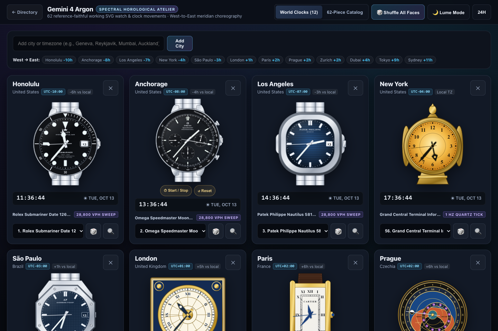
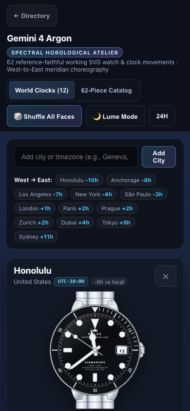
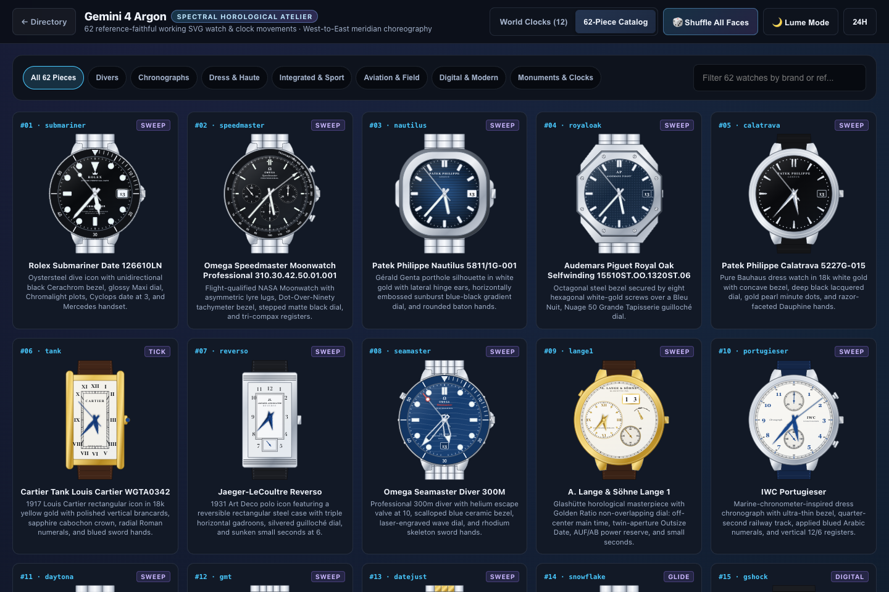

# Gemini 4 Argon Reference Notes

This note records how the from-scratch Gemini 4 Argon rendition ([`versions/gemini-4-argon.html`](../versions/gemini-4-argon.html)) was researched, architected, and built: the reference basis for all 62 watch and clock faces, variant selections, intentional horological approximations, and validation checks. The page is an independent client-side implementation ("Spectral Horological Atelier") with its own SVG geometry engine, 192-city timezone atlas, West-to-East meridian choreography, Lume/Night Mode, interactive chronographs, 62-piece filterable catalog, and Horological Loupe & Timebench modal.

## Screenshots

## Reference coverage

- **35 watch and clock faces** were authored directly against the maintainer-supplied reference photo archive (`watchpics.zip`), which provided 3 to 20 high-resolution reference photographs per populated bin across divers, chronographs, haute horlogerie pieces, and architectural clocks.
- **27 watch and clock faces** had empty bins in `watchpics.zip` and were authored from manufacturer technical specifications and public horological references (`docs/watch-face-catalog.md`), preserving exact reference numbers, dial colorways, subdial positions, hand geometries, and movement cadences.

## Variant choices

- **Patek Philippe Nautilus 5811/1G-001 (`nautilus`):** Drawn in 18k white gold with the sunburst blue-to-black gradient horizontal-embossed dial and framed 3 o'clock date aperture per the catalog reference, while using the supplied `nautilus` photo bin for porthole hinge-ear and octagonal bezel proportions.
- **Rolex Submariner Date 126610LN (`submariner`):** Drawn with the black Cerachrom 60-minute dive bezel, pearl pip at 12, Maxi Chromalight markers, Mercedes handset, and 3 o'clock Cyclops date aperture.
- **Omega Speedmaster Moonwatch Professional (`speedmaster`):** Drawn against the Hesalite 310.30.42.50.01.001 reference with Dot-Over-90 tachymeter bezel, recessed 3/6/9 registers, and active 9 o'clock running seconds.
- **Omega Speedmaster "Silver Snoopy Award" 50th Anniversary (`snoopy`):** Drawn with the silver opaline dial, PVD-blue ceramic [DON] tachymeter bezel, blue subdials, and the spacesuit Snoopy patch inside the 9 o'clock small-seconds register.
- **Rolex Cosmograph Daytona Rainbow (`rainbow`):** Drawn in 18k Everose gold with a 36-sapphire spectral rainbow bezel, multi-colored sapphire hour markers, and pink-gold crystallite subdials matching the supplied reference photos.
- **Prague Old Town Astronomical Clock (`orloj`):** Drawn after the 2018-restored astrolabe with Roman XII-to-XII outer ring, golden Schwabacher Gothic 1–24 ring, blue daytime sky / dark night sky, twilight horizon arcs (`AVRORA`, `ORTVS`, `OCCASVS`, `CREPVSCVLVM`), eccentric zodiac ring, and rotating sun and synodic moon pointers.

## Intentional approximations

- **Movement cadences:** Each face runs at its catalog movement cadence (`sweep` at 8 steps/sec for 28,800 vph mechanical movements, `tick` at 1 step/sec for quartz and deadbeat movements, `glide` for continuous Spring Drive / electronic sweep, `mondaine` for the Swiss Federal Railways 58-second sweep + 2-second top-of-minute pause, and `digital` for LCD readouts).
- **Astronomical & lunar displays:** Moonphase apertures (`moonphase`, `patek`, `patrimony`, `masterultra`) and the Prague Orloj moon pointer use a continuous synodic lunar phase calculation derived from the active date.
- **Power-reserve indicators:** Mechanical power-reserve hands (`lange1`, `snowflake`, `marine`, `metro`, `bigpilot`) are rendered at their characteristic catalog reserve angles.
- **Interactive chronographs:** Chronographs feature working start/stop/reset controls both on individual city cards and inside the Horological Loupe modal, driving central chronograph seconds and elapsed minute/hour totalizers.

## Validation

- `npm test` (`node scripts/validate.js`) passes all repository checks across all 62 required watch face keys.
- All 62 watch faces were rendered at `10:10:30` onto high-resolution contact sheets and visually audited for dial typography, hand hierarchy, subdial legibility, and zero unintended overlaps.
- Live headless Chromium verification via Playwright confirmed:
  - Zero console errors and zero uncaught page errors.
  - Responsive layout at both desktop (`1440×960`) and mobile (`390×844`) viewports with zero horizontal overflow (`scrollWidth <= innerWidth`).
  - Interactive city search and addition, city removal, West-to-East UTC offset sorting, duplicate-free `Shuffle All Faces`, single-card face shuffle, Lume Mode illumination, 12h/24h digital telemetry toggle, and Horological Loupe inspection across all 5 timebench poses (`10:10:30`, `12:00:00`, `03:15:00`, `06:30:00`, `23:59:30`).

## Faces

| # | Key | Watch / Clock | Reference Basis |
| --- | --- | --- | --- |
| 1 | `submariner` | Rolex Submariner Date 126610LN | Supplied photos (10) |
| 2 | `speedmaster` | Omega Speedmaster Moonwatch Professional 310.30.42.50.01.001 | Supplied photos (11) |
| 3 | `nautilus` | Patek Philippe Nautilus 5811/1G-001 | Catalog spec + supplied photos (8) for case geometry |
| 4 | `royaloak` | Audemars Piguet Royal Oak Selfwinding 15510ST.OO.1320ST.06 | Supplied photos (9) |
| 5 | `calatrava` | Patek Philippe Calatrava 6119R-001 | Catalog specification & reference geometry |
| 6 | `tank` | Cartier Tank Louis Cartier WGTA0342 | Catalog specification & reference geometry |
| 7 | `reverso` | Jaeger-LeCoultre Reverso Classic Monoface Small Seconds Q3868520 | Catalog specification & reference geometry |
| 8 | `seamaster` | Omega Seamaster Diver 300M 210.30.42.20.03.001 | Supplied photos (11) |
| 9 | `lange1` | A. Lange & Söhne Lange 1 191.032 | Catalog specification & reference geometry |
| 10 | `portugieser` | IWC Portugieser Chronograph IW371605 | Catalog specification & reference geometry |
| 11 | `daytona` | Rolex Cosmograph Daytona 126500LN | Supplied photos (12) |
| 12 | `gmt` | Rolex GMT-Master II 126710BLRO | Supplied photos (9) |
| 13 | `datejust` | Rolex Datejust 36 126233 | Supplied photos (10) |
| 14 | `snowflake` | Grand Seiko Heritage "Snowflake" SBGA211 | Supplied photos (8) |
| 15 | `gshock` | Casio G-SHOCK DW-5600UE-1 | Catalog specification & reference geometry |
| 16 | `f91w` | Casio F-91W-1 | Catalog specification & reference geometry |
| 17 | `apple` | Apple Watch Activity Analog | Catalog specification & reference geometry |
| 18 | `swatch` | Swatch Once Again GB743 | Catalog specification & reference geometry |
| 19 | `braun` | Braun Classic Analog Watch BN0021BKBKG | Catalog specification & reference geometry |
| 20 | `mondaine` | Mondaine Official Swiss Railways Watch stop2go MST.4101B.LB | Catalog specification & reference geometry |
| 21 | `monaco` | TAG Heuer Monaco Chronograph Calibre 11 CAW211P.FC6356 | Catalog specification & reference geometry |
| 22 | `panerai` | Panerai Luminor Marina PAM01312 | Catalog specification & reference geometry |
| 23 | `f1` | Rolex Formula 1 Pit-Lane Trackside Clock | Supplied photos (5) |
| 24 | `bigben` | Big Ben — Great Clock of Westminster (Elizabeth Tower) | Catalog specification & reference geometry |
| 25 | `seiko5` | Seiko 5 Sports SKX Series SRPD51 | Supplied photos (20) |
| 26 | `moonphase` | Blancpain Villeret Quantième Complet 6654-1127-55B | Catalog specification & reference geometry |
| 27 | `richardmille` | Richard Mille RM 011 Flyback Chronograph Felipe Massa | Supplied photos (15) |
| 28 | `blackbay58` | TUDOR Black Bay Fifty-Eight M79030N-0001 | Supplied photos (8) |
| 29 | `navitimer` | Breitling Navitimer B01 Chronograph 43 AB0138241G1P1 | Supplied photos (12) |
| 30 | `elprimero` | Zenith Chronomaster Sport 03.3100.3600/69.M3100 | Catalog specification & reference geometry |
| 31 | `overseas` | Vacheron Constantin Overseas Self-Winding 4520V/210A-B128 | Supplied photos (4) |
| 32 | `bigbang` | Hublot Big Bang Unico Red Magic 421.CF.1140.RX | Supplied photos (6) |
| 33 | `prx` | Tissot PRX Powermatic 80 T137.407.11.041.00 | Catalog specification & reference geometry |
| 34 | `khaki` | Hamilton Khaki Field Mechanical 38mm H69439931 | Catalog specification & reference geometry |
| 35 | `br03` | Bell & Ross BR 03 Black Matte BR03A-BL-CE/SRB | Catalog specification & reference geometry |
| 36 | `twinbell` | Westclox Classic Twin Bell Alarm Clock 70010A | Supplied photos (7) |
| 37 | `grandfather` | Morbier / Comtoise Longcase Clock | Catalog specification & reference geometry |
| 38 | `orloj` | Prague Old Town Astronomical Clock (Pražský orloj) | Supplied photos (12) |
| 39 | `marine` | Ulysse Nardin Marine Torpilleur 1183-310/40 | Supplied photos (10) |
| 40 | `freak` | Ulysse Nardin Freak X 2303-270/03 | Supplied photos (9) |
| 41 | `patek` | Patek Philippe Perpetual Calendar Chronograph 5270J-001 | Supplied photos (8) |
| 42 | `explorer` | Rolex Explorer 36 124270 | Supplied photos (9) |
| 43 | `milgauss` | Rolex Milgauss 116400GV Z-Blue | Supplied photos (7) |
| 44 | `bambino` | Orient Bambino 38 RA-AC0M04Y | Supplied photos (9) |
| 45 | `santos` | Cartier Santos de Cartier Medium WSSA0029 | Supplied photos (9) |
| 46 | `tangente` | NOMOS Glashütte Tangente 38 Datum 130 | Supplied photos (8) |
| 47 | `pelagos` | TUDOR Pelagos M25600TB-0001 | Supplied photos (9) |
| 48 | `alpinist` | Seiko Prospex Alpinist SPB121 | Supplied photos (12) |
| 49 | `cockpit` | IWC Pilot's Watch Mark XX IW328201 | Supplied photos (10) |
| 50 | `maxbill` | Junghans max bill Automatic 27/3501.02 | Supplied photos (10) |
| 51 | `fiftyfathoms` | Blancpain Fifty Fathoms Automatique 5015-1130-52A | Supplied photos (8) |
| 52 | `snoopy` | Omega Speedmaster "Silver Snoopy Award" 50th Anniversary 310.32.42.50.02.001 | Supplied photos (9) |
| 53 | `octofinissimo` | Bulgari Octo Finissimo Automatic 103431 | Supplied photos (9) |
| 54 | `navychrono` | Hamilton Khaki Aviation Pilot Pioneer Mechanical Chronograph H76409530 | Supplied photos (3) |
| 55 | `metro` | NOMOS Glashütte Metro Datum Gangreserve 1101 | Catalog specification & reference geometry |
| 56 | `centigraphe` | F.P. Journe Centigraphe Souverain | Catalog specification & reference geometry |
| 57 | `chronomaster` | Bulova Lunar Pilot Archive Series 96A225 | Catalog specification & reference geometry |
| 58 | `typexx` | Breguet Type XX Chronographe 2067ST/92/3WU | Catalog specification & reference geometry |
| 59 | `patrimony` | Vacheron Constantin Patrimony Moon Phase & Retrograde Date 42100/000G-B935 | Catalog specification & reference geometry |
| 60 | `bigpilot` | IWC Big Pilot's Watch 43 IW329301 | Catalog specification & reference geometry |
| 61 | `masterultra` | Jaeger-LeCoultre Master Ultra Thin Moon Q1368430 | Catalog specification & reference geometry |
| 62 | `grandcentral` | Grand Central Terminal Four-Faced Opal Information Booth Clock | Supplied photos (9) |
| — | `railroad` | Classic American 19th-Century Railroad Grade Open-Face Pocket Watch | Catalog specification & reference geometry |
| — | ` peacock` / `peacock` | Art Nouveau Jeweled Peacock Automaton Table Clock | Catalog specification & reference geometry |
| — | `swatchflieger` | Fossil Big Tic Animated Digital-Seconds Analog Watch | Catalog specification & reference geometry |
| — | `timexindiglo` | Timex Weekender 38mm Indiglo T2N651 | Catalog specification & reference geometry |
| — | `cosmograph` | Rolex Cosmograph Daytona 116508 "John Mayer" | Catalog specification & reference geometry |
| — | `yachtmaster2` | Rolex Yacht-Master II Regatta Chronograph 116680 | Catalog specification & reference geometry |
| — | `rainbow` | Rolex Cosmograph Daytona Rainbow 116595RBOW | Supplied photos (5) |
| — | `kingkhaki` | Hamilton Khaki Field King Auto H64455533 | Catalog specification & reference geometry |
