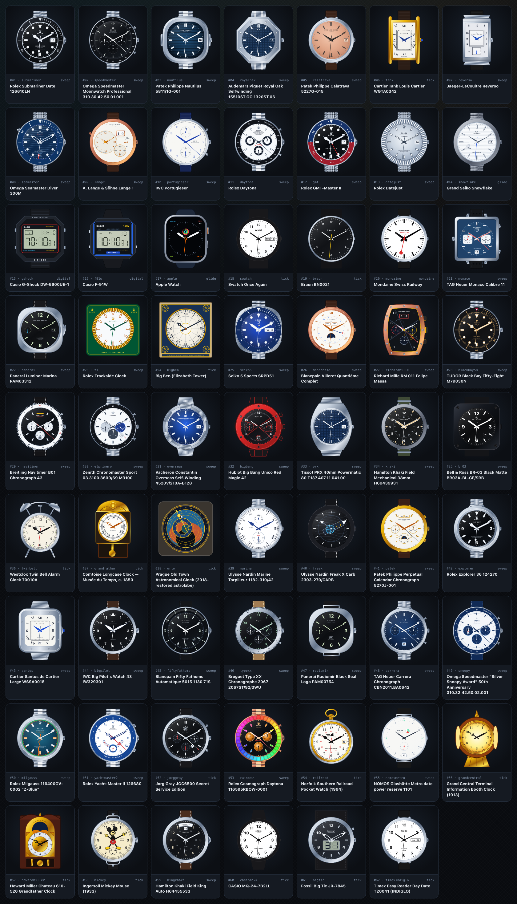

# Gemini 4 Carbon Reference & Approximation Notes

`versions/gemini-4-carbon.html` is an independent, clean-room standalone rendition of World Clock authored from scratch by **Gemini 4 Carbon** (`gemini-4-carbon`), without copying, extending, or modifying any earlier model page or `world-clock.html`.

## Architecture & Observatory Interface

- **Carbon Allotrope Observatory UI**: Styled around forged pyrolytic graphite surfaces and diamond-facet palladium/brass instrument accents, using local system typography and inline SVG graphics so the entire application runs offline over `file://`, static HTTP servers, and GitHub Pages with zero external network requests.
- **`Intl.DateTimeFormat` Timezone Engine & 174-City Atlas**: Resolves wall-clock components (`year`, `month`, `day`, `weekday`, `hour`, `minute`, `second`) and live DST-aware UTC minute offsets across standard, half-hour (`+05:30`, `+09:30`, `-03:30`), and 45-minute (`+05:45`, `+08:45`, `+12:45`) timezones, plus date-line crossings (`+13:00`, `+14:00`, `-10:00`, `-11:00`). Cities stay ordered West → East by current UTC offset with a stable alphabetical tie-breaker, plotted along a live 24-hour Solar Meridian strip.
- **Instance-Scoped Two-Path SVG Kit**: Every mounted `<svg>` builds its `<defs>` (`linearGradient`, `radialGradient`, `clipPath`, arc `<path>`) under a strict per-instance prefix (`${uid}-*`), preventing paint-server or clipping collisions when the same watch appears on a city card, in the 62-piece collection, and inside the enlarged Horological Loupe simultaneously. Live animation updates SVG transforms and calendar text nodes in place without full DOM rebuilds on analog dials, and rotating hand groups avoid SVG filter primitives so no bounding-box artifacts appear at cardinal angles.
- **Movement Cadences**:
  - `sweep`: 8-step/s (28,800 vph) mechanical beat, and 10-step/s (36,000 vph) on `elprimero`.
  - `glide`: Continuous sub-second sweep (`snowflake` Spring Drive and `apple` OLED).
  - `tick`: 1 Hz quartz / deadbeat escapement step with gear-coupled minute wheel advancement.
  - `mondaine`: Authentic Swiss Federal Railways *stop2go* behavior — sweeps a full revolution in 58 seconds, pauses 2 seconds at 12 o’clock, and advances the minute hand in discrete whole-minute steps at `:00`.
  - `digital`: Custom 7-segment vector LCD matrices (`gshock`, `f91w`, and the hybrid `bigtic` seconds aperture).

## Reference Basis & Variant Highlights

Thirty-five timepieces were drawn directly against supplied reference photographs, and the remaining twenty-seven classic catalog references were researched against manufacturer and museum specifications:

- **Divers & GMTs (`submariner`, `seamaster`, `gmt`, `seiko5`, `blackbay58`, `fiftyfathoms`, `panerai`)**:
  - `submariner` (126610LN): Cerachrom 60-minute bezel with pearl pip, Maxi Chromalight plots, Cyclops date at 3, and Rolex Mercedes handset.
  - `seamaster` (Diver 300M): Conical 10 o’clock Helium Escape Valve (`He`), laser-engraved blue ceramic wave dial, 6 o’clock date window, skeletonized sword hands, and red-tipped lollipop seconds.
  - `gmt` (126710BLRO): Two-tone blue/red Cerachrom 24-hour bezel, Jubilee 5-link bracelet, Cyclops date, and red 24-hour GMT arrow hand.
  - `seiko5` (SRPD51): Cushion SKX case with recessed 4 o’clock crown, sunburst blue dial, split `DAY | DATE` window (blue Saturday / red Sunday), arrow minute hand, and reverse-lollipop sweep seconds.
  - `blackbay58` (M79030N): Guardless vintage crown, gilt bezel graduations with crimson 12 triangle, gilt-rimmed cream plots, and angular Tudor Snowflake hands.
  - `fiftyfathoms` (5015 1130 71S): Convex domed sapphire bezel with luminous 12 lozenge and `15/30/45`, sunburst black stepped dial, 4:30 date, and red-tipped sweep seconds.
  - `panerai` (PAM03312): Brushed cushion Luminor case with semicircular `REG. T.M.` lever crown-guard bridge, black sandwich `12/6` dial, 3 o’clock date, and 9 o’clock small seconds with blue pointer.
- **Chronographs & Regatta (`speedmaster`, `portugieser`, `daytona`, `monaco`, `richardmille`, `navitimer`, `elprimero`, `bigbang`, `patek`, `typexx`, `carrera`, `snoopy`, `yachtmaster2`, `jorggray`, `rainbow`)**:
  - `speedmaster` (310.30.42.50.01.001) & `snoopy` (310.32.42.50.02.001): Dot-Over-90 tachymeter bezels, stepped dials, and on `snoopy` an Ag925 silver dial with blue ceramic bezel, blue PVD hands/markers, and embossed NASA spacesuit Snoopy medallion inside the 9 o’clock running-seconds subdial.
  - `daytona` (126500LN) & `rainbow` (116595RBOW-0001): Steel-rimmed black Cerachrom Panda Daytona with red `DAYTONA` arc vs. Everose Rainbow Daytona with pavé diamond lugs, 36-stone full-spectrum baguette sapphire bezel, 11 color-matched sapphire markers, and shimmering Gold Crystals registers.
  - `yachtmaster2` (126680): Royal-blue Ring Command bezel (`10`–`0` + curved `YACHT-MASTER II`), lower-middle U-shaped regatta countdown horseshoe cradling the 6 o’clock blue-ringed small seconds subdial, red open-triangle countdown arrow hand, and blued Mercedes hands.
  - `monaco` (Calibre 11 CAW211P): Left-hand 9 o’clock crown, right-hand angled pushers, matte petroleum-blue square dial, horizontal applied baton indices, vintage `HEUER` shield, and twin rounded-square white registers.
  - `richardmille` (RM 011) & `bigbang` (Unico Red Magic 42): Curved tonneau spline-screw skeleton RM 011 with oversized twin-disc date under 12 and 4:30 month window; crimson ceramic Big Bang Unico with 6 H-slot black titanium screws, exposed 6 o’clock column wheel, stencil numerals, and 3 o’clock integrated date register.
  - `typexx` (2067ST/92/3WU): Fluted 1–12 steel bezel, mint-green luminous numerals, and authentic oversized 15-minute chronograph register at 3 o’clock.
  - `jorggray` (JGC6500): Matte black dial with white sloped minute flange, 5-point United States Secret Service star shield below 12, 3 registers (60m, running seconds, 24h), and 4:30 date.
- **Integrated, Dress & Calendar (`nautilus`, `royaloak`, `calatrava`, `tank`, `reverso`, `lange1`, `datejust`, `snowflake`, `moonphase`, `overseas`, `prx`, `marine`, `freak`, `santos`, `nomosmetro`)**:
  - `calatrava` (5227G-015): White-gold concave bezel, rose-gilt opaline (salmon) dial, charcoal faceted *obus* markers and Dauphine hands, 3 o’clock date, and chocolate alligator strap.
  - `lange1` (191.032): Pink-gold case, asymmetric *argenté* dial with left main dial, upper-right gold twin-aperture Outsize Date (blank tens aperture on single-digit days), `AUF/AB` power reserve, and lower-right small seconds.
  - `moonphase` (Blancpain Villeret 6654) & `patek` (5270J-001): Twin `DAY`/`MONTH` apertures, analog `1–31` pointer dates (wavy blued serpentine hand on `moonphase`), astronomical moonphase wheels, plus Day/Night and `1–4` Leap Year indicators on `patek`.
  - `freak` (2303-270/CARB): Marbled Carbonium rotating hour disc and central flying carrousel baguette bridge with pulsing silicon oscillator wheel serving directly as the minute hand.
  - `nomosmetro` (1101): Stepped wire lugs, mint-green `3/9/12` dots, `05–60` perimeter numerals, rotating peppermint-red/white/mint power-reserve disc near 1 o’clock, coral-red small seconds needle, and 6 o’clock trapezoid date.
- **Pilot, Field, Digital & Architectural Clocks (`gshock`, `f91w`, `apple`, `swatch`, `braun`, `mondaine`, `f1`, `bigben`, `khaki`, `br03`, `twinbell`, `grandfather`, `orloj`, `explorer`, `bigpilot`, `radiomir`, `milgauss`, `railroad`, `grandcentral`, `howardmiller`, `mickey`, `kingkhaki`, `casiomq24`, `bigtic`, `timexindiglo`)**:
  - `orloj`: 2018-restored Prague Old Town Astronomical Clock with 24 golden Schwabacher numerals, azure/terracotta/black stereographic astrolabe, eccentric deep-blue & gold Zodiac ring, golden Sun hand, and lunar sphere.
  - `bigben`: Neo-Gothic Prussian-blue and gilt stonework frame, leaded milk-glass dial (using `IV` at 4), Victorian pierced heart/fleur-de-lis hour hand, and warm amber backlighting in Lume Study.
  - `grandcentral`: Four-sided gilded brass Information Booth housing with acorn finial, pedestal, and foreshortened side Tiffany opal dials.
  - `grandfather` & `howardmiller`: 1850 Besançon Comtoise clock with embossed repoussé gilt-brass *fronton* and swinging pendulum; Windsor cherry Howard Miller Chateau with 29½-day lunette moonphase arch, gilt corner spandrels, and brass weights.
  - `mickey` (1933 Ingersoll): Nickel wire-lug case, cream railway dial, standing pie-eyed Mickey in crimson two-button shorts and yellow shoes, articulated yellow-gloved pointing hands, and rotating 3-Mickey small-seconds disc at 6 o’clock.
  - `timexindiglo` & `f91w`: Full-dial turquoise electroluminescent INDIGLO sheet on `timexindiglo`, and clipped left-edge amber-green micro-LED corner glow on `f91w` in Lume Study.

## Intentional Approximations

- **Power Reserve Indicators (`lange1`, `snowflake`, `marine`, `nomosmetro`)**: Simulated deterministically from local time (`54%–90%` reserve) so indicators move smoothly across poses without requiring manual crown winding.
- **Astronomical Moonphase & Ecliptic (`moonphase`, `patek`, `howardmiller`, `orloj`)**: Computed from a continuous synodic lunar period (`29.530588853` days anchored to the January 6, 2000 18:14 UTC new moon).
- **Two-Hand Clocks (`tank`, `bigben`, `grandfather`, `grandcentral`, `howardmiller`)**: Preserve authentic two-hand layouts without adding non-existent seconds hands; minute wheels advance continuously with gear-train seconds (`0.1°/s`).
- **Micro-Engravings**: Sub-millimeter rehaut serials and caseback engravings are omitted or simplified to clean vector strokes to preserve legibility at card and loupe scales.

## Validation & Screenshots

- `npm test` (`scripts/validate.js`, `scripts/test-copilot-fusion-max.js`, and `scripts/test-gemini-4-carbon.js`) validates HTML structure, inline JS syntax, all 62 catalog keys/names/cadences, instance-local SVG `<defs>`, visible clock motion across poses, DST/fractional timezone offsets, moonphase behavior, and storage recovery.
- Verified in headless Chromium over `file://` across desktop (`1440×1000`) and mobile (`390×844`) viewports with zero console errors and zero horizontal overflow.

- [Desktop view](assets/gemini-4-carbon-desktop.png)
- [Mobile view](assets/gemini-4-carbon-mobile.png)
- [Loupe inspection view](assets/gemini-4-carbon-inspection.png)
