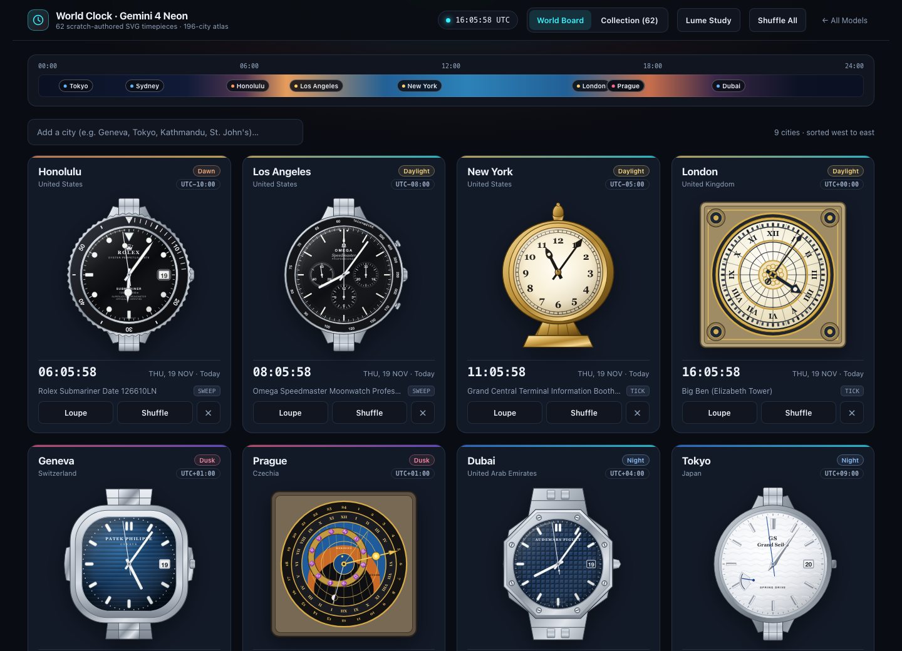
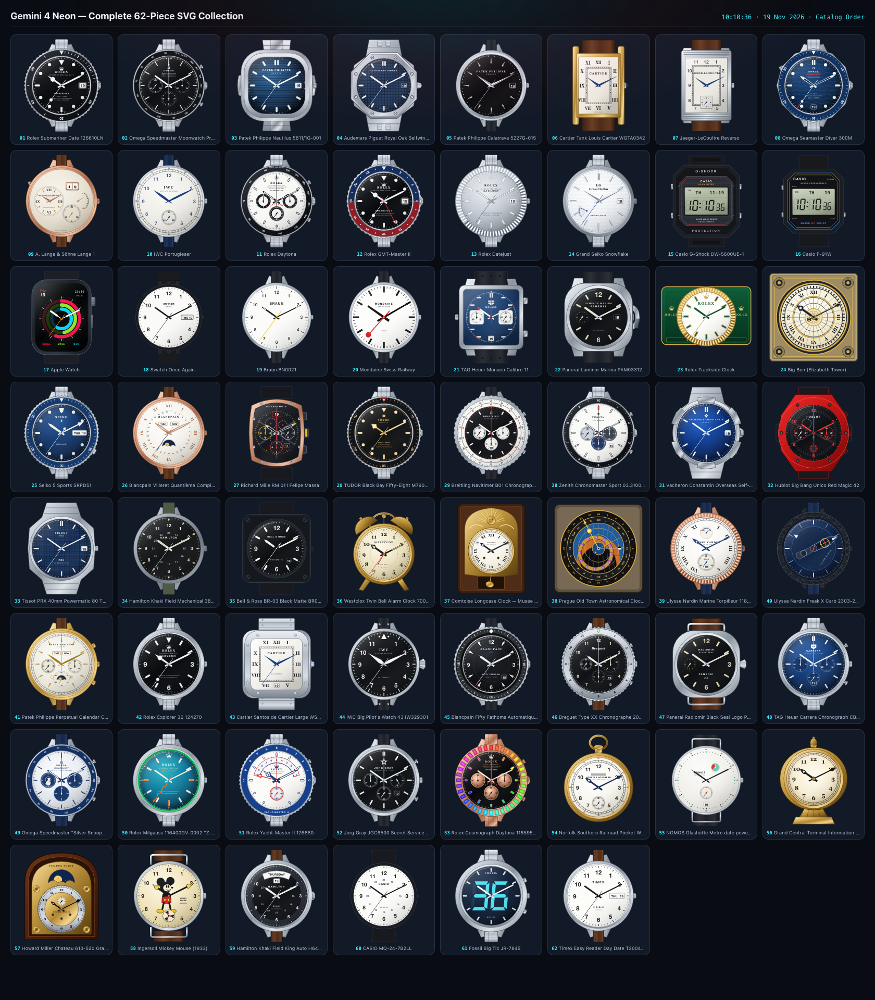

# Gemini 4 Neon Reference Notes

This document summarizes the reference basis, horological design choices, intentional approximations, and browser/automated validation for `versions/gemini-4-neon.html`, an independent standalone rendition authored from scratch.

## Overview

- **Standalone file**: [`versions/gemini-4-neon.html`](../versions/gemini-4-neon.html)
- **Model release date**: November 18, 2026 ([Google DeepMind announcement](https://deepmind.google/blog/introducing-gemini-4-neon/))
- **Project snapshot date**: November 19, 2026
- **Catalog coverage**: All 62 timepieces in [`docs/watch-face-catalog.md`](watch-face-catalog.md), in exact catalog order and cadence.
- **Timezone atlas**: 196 IANA cities covering all standard, half-hour (`+05:30`, `-03:30`, `+03:30`, `+06:30`, `+09:30`, `-09:30`, `+10:30`), and quarter-hour (`+05:45`, `+08:45`, `+12:45`) zones, ordered west to east by live UTC offset with alphabetical tie-breaking.

## Rendered Collection & Views

[Mobile layout (390px)](assets/gemini-4-neon-mobile.png) · [Loupe & Timebench inspection (Rolex Yacht-Master II 126680)](assets/gemini-4-neon-inspection.png)

## Reference Coverage

All 62 timepieces were drawn as pure inline SVG geometry with instance-scoped `<defs>` IDs and no external raster or font dependencies.

- **Maintainer-supplied reference photographs (35 faces)**: Consulted directly for case geometry, lugs, crowns, bezel scales, dial colors, subdials, hand styles, and text placement on `bigbang`, `bigpilot`, `blackbay58`, `carrera`, `datejust`, `daytona`, `explorer`, `f1`, `freak`, `gmt`, `grandcentral`, `howardmiller`, `jorggray`, `marine`, `mickey`, `milgauss`, `nautilus`, `navitimer`, `nomosmetro`, `orloj`, `overseas`, `patek`, `rainbow`, `richardmille`, `royaloak`, `santos`, `seamaster`, `seiko5`, `snoopy`, `snowflake`, `speedmaster`, `submariner`, `twinbell`, `typexx`, and `yachtmaster2`.
- **Catalog-specific reference fidelity**: Where the catalog specifies a particular reference (such as the Patek Philippe Nautilus `5811/1G-001` blue sunburst-to-black dial, Hublot Big Bang Unico Red Magic 42 red ceramic skeleton, Ulysse Nardin Marine Torpilleur `1182-310/42` white enamel dial, and Patek Philippe `5270J-001` yellow gold perpetual calendar chronograph), the SVG follows that exact cataloged reference.
- **Additional 27 catalog timepieces**: Drawn from horological specifications and visual references covering `apple`, `bigben`, `bigtic`, `br03`, `braun`, `calatrava`, `casiomq24`, `elprimero`, `f91w`, `fiftyfathoms`, `grandfather`, `gshock`, `khaki`, `kingkhaki`, `lange1`, `monaco`, `mondaine`, `moonphase`, `panerai`, `portugieser`, `prx`, `radiomir`, `railroad`, `reverso`, `swatch`, `tank`, and `timexindiglo`.

## Movement Physics & Working Complications

- **Cadences**:
  - `tick`: 1 Hz discrete second step.
  - `sweep`: 8 Hz (28,800 vph) mechanical beat; 10 Hz (36,000 vph) on the Zenith Chronomaster Sport (`elprimero`).
  - `glide`: Continuous smooth glide on Grand Seiko Snowflake (`snowflake`) and Apple Watch (`apple`).
  - `mondaine`: Authentic Swiss Federal Railways `stop2go` motion — 58.5-second sweep, 1.5-second pause at 12 o'clock, and crisp minute jump.
  - `digital`: Custom polygonal 7-segment LCD digits with ghosted off-segments, blinking colons, live day/date/month, and interactive stopwatch display (`gshock`, `f91w`).
- **Interactive Chronographs & Regatta Countdown (16 faces)**: All 13 mechanical chronographs, 2 Casio digital stopwatches, and the Rolex Yacht-Master II regatta timer support live Start/Stop and Reset via both the Inspector workbench and clickable SVG pushers. Zenith's central chronograph hand completes one full revolution every 10 seconds (`1/10s` bezel scale); Yacht-Master II programs 1–10 minute regatta countdowns sweeping across the 10-to-0 arch.
- **Calendar & Astronomical Complications**: Live local date, split tens/ones outsize date (`lange1`), day-of-week & full-weekday arches (`kingkhaki`, `seiko5`, `swatch`, `timexindiglo`), month & leap-year indicators (`patek`, `moonphase`, `richardmille`), 24-hour GMT hand (`gmt`), synodic astronomical moonphase discs (`moonphase`, `patek`, `howardmiller`, `orloj`), and simulated mechanical power reserves (`lange1`, `snowflake`, `marine`, `nomosmetro`).
- **Lume Study Mode**: Distinguishes Chromalight ice-blue, Super-LumiNova BGW9 aqua, C3 green, vintage patina radium-green, full-dial Timex INDIGLO cyan-aqua, Casio EL teal, and F-91W green micro-LED illumination.

## Intentional Approximations

- **Openworked & astronomical dials**: Skeleton bridges (`richardmille`, `bigbang`), the Ulysse Nardin Freak X flying carousel balance, the Prague Orloj stereographic astrolabe, and the 1933 Ingersoll Mickey Mouse rotating three-Mickey seconds disc are stylized cleanly in vector geometry to stay crisp at both card and loupe sizes.
- **Power reserve & activity rings**: Mechanical power reserves (`lange1`, `snowflake`, `marine`, `nomosmetro`) and Apple Watch Activity Analog Move/Exercise/Stand rings use deterministic time-of-day simulations rather than external hardware telemetry.
- **Photorealistic textures**: Brushed steel, fluted bezels, Grande Tapisserie waffle dials, laser-engraved Seamaster waves, forged Carbonium®, Snowflake frost, and 36 graded rainbow baguette sapphires (`rainbow`) are rendered with procedural SVG gradients and patterns rather than raster textures.

## Validation

- Automated Node test suite: `node --test scripts/test-gemini-4-neon.js` (catalog parity, zero external URLs, finite geometry and strictly instance-scoped `<defs>` across 6 edge poses, visible time updates across all 62 faces, cadence/chrono/regatta physics, DST & fractional-offset timezone math, and 16 chronograph pushers).
- Repository validation: `npm test` (`scripts/validate.js` plus all model test suites).
- Headless Chrome verification: Tested desktop (`1440×1040`), true mobile emulation (`390×844`, `scrollWidth === innerWidth === 390`, zero console errors), 62-piece contact plate, Lume Study, duplicate-free shuffle-all and per-card shuffle, add/remove city, and Loupe inspection.
