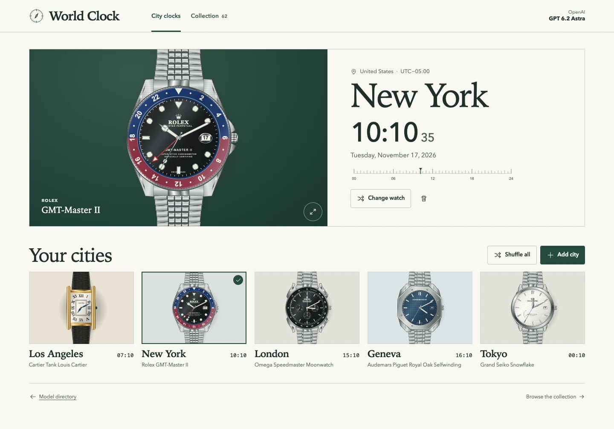
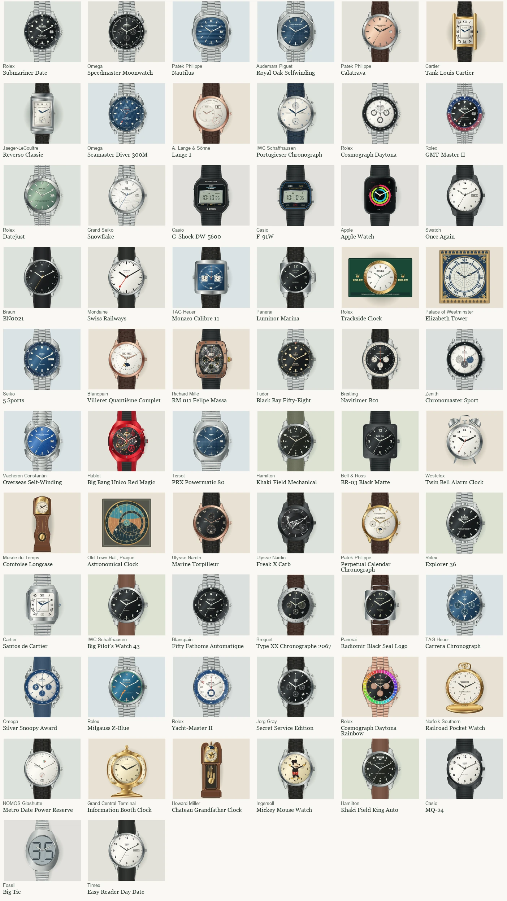

# OpenAI GPT 6.2 Astra

The [standalone rendition](../versions/gpt-6.2-astra.html) draws each of the 62 catalogued timepieces in inline SVG. The same drawing powers its city clock, collection thumbnail and magnified dial. Each instance has its own paint, clip and movement bindings.

[Phone view](assets/gpt-6.2-astra-mobile.webp) · [Chronomaster Sport inspection](assets/gpt-6.2-astra-inspection.webp) · [Full collection plate](assets/gpt-6.2-astra-faces.webp)

## Photographic basis

The supplied collection contained photographs for 35 of the 62 objects. For the other 27, the drawings use published product, collection or auction references. Where the supplied photographs show several editions, the catalog reference determines the dial, case and complication layout. The table records the distinguishing features used in each drawing.

| Timepiece | Details studied | Reference |
| --- | --- | --- |
| Rolex Submariner Date | The ceramic minute bezel frames a glossy black dial. A magnifying lens sits over the date at three. | Supplied photographs |
| Omega Speedmaster Moonwatch | The stepped black dial carries three recessed registers beneath a white baton handset. | Supplied photographs |
| Patek Philippe Nautilus | Horizontal embossing follows the blue dial into its rounded octagonal corners. The case projects into a hinge on either side. | Supplied photographs · [Catalog reference](https://www.patek.com/en/collection/nautilus/5811-1G-001) |
| Audemars Piguet Royal Oak Selfwinding | Eight slotted hexagonal screws sit flush with the brushed octagonal bezel. The blue tapisserie dial has a double index at twelve. | Supplied photographs · [Catalog reference](https://www.audemarspiguet.com/us/en/watch-collection/royal-oak/15510ST.OO.1320ST.06) |
| Patek Philippe Calatrava | Dark faceted hands and applied batons stand out against rose-gilt opaline. A fine railway track defines the dial edge. | [Published reference](https://www.patek.com/en/collection/calatrava/5227g-015) |
| Cartier Tank Louis Cartier | Two rounded gold brancards frame a rectangular minute track. A blue cabochon echoes the sword hands. | [Published reference](https://www.jaztime.com/tank-louis-cartier-small-quartz-yellow-gold-silver-dial-wgta0342) |
| Jaeger-LeCoultre Reverso Classic | Horizontal gadroons bookend a rectangular silver dial. The small seconds run in a square register at six. | [Published reference](https://www.jaeger-lecoultre.com/ch-en/watches/reverso/reverso-classic/reverso-classic-monoface-small-seconds-stainless-steel-q3858523) |
| Omega Seamaster Diver 300M | Skeleton hands reveal the engraved waves underneath. The helium escape valve sits opposite the guarded crown. | Supplied photographs |
| A. Lange & Söhne Lange 1 | The hours and minutes share an off-centre dial. A framed outsize date and small seconds occupy the right half. | [Published reference](https://www.alange-soehne.com/es-en/timepieces/lange-1/lange-1/lange-1-in-750-pink-gold-191-032) |
| IWC Schaffhausen Portugieser Chronograph | Blued numerals surround two vertically aligned counters. The running seconds sit at six and elapsed minutes at twelve. | [Published reference](https://www.iwc.com/eu-en/watches/portugieser/iw371605-portugieser-chronograph) |
| Rolex Cosmograph Daytona | Dark counter rings and a black ceramic tachymeter frame the white dial. The red Daytona signature arcs over running seconds. | Supplied photographs |
| Rolex GMT-Master II | A red arrow reads UTC on the two-colour 24-hour bezel. Five rows of bracelet links catch the light at different angles. | Supplied photographs |
| Rolex Datejust | A fluted bezel picks up alternating bands of light around the mint dial. The date sits beneath a separate crystal lens. | Supplied photographs |
| Grand Seiko Snowflake | Fine broken lines give the dial its snow texture. A blued seconds hand glides above the recessed reserve scale. | Supplied photographs |
| Casio G-Shock DW-5600 | A shock-resistant resin surround protects the recessed LCD. The weekday and calendar occupy its upper row. | [Published reference](https://www.casio.com/intl/watches/gshock/product.DW-5600UE-1/) |
| Casio F-91W | Blue pinstripes and a thin gold line frame the grey-green LCD. Seconds have their own smaller electrodes. | [Published reference](https://www.casio.com/latin/watches/casio/standard/standard/products/f-91w/) |
| Apple Apple Watch | Three coloured activity rings sit beneath a white analogue handset. The crown is knurled into the rounded case flank. | [Published reference](https://support.apple.com/guide/watch/apde9218b440/watchos) |
| Swatch Once Again | A slim black case and moulded strap surround an open white dial. The day and date share a window at three. | [Published reference](https://www.swatch.com/en-gb/once-again-black-gb743-eb/GB743-EB.html) |
| Braun BN0021 | Fine white minutes surround compact numerals on the black dial. The yellow seconds hand and smooth black strap follow the BN0021BKBKG. | [Published reference](https://braun-clocks.com/products/braun-gents-bn0021-classic-watch-black-dial-and-black-leather-strap) |
| Mondaine Swiss Railways | The round red seconds paddle pauses at twelve before the minute hand steps forward. | [Published reference](https://mondaine.com/pages/stop2go) |
| TAG Heuer Monaco Calibre 11 | A left-hand crown balances twin pushers on the square case. Horizontal applied markers surround two square registers. | [Published reference](https://www.tagheuer.com/in/en/timepieces/collections/tag-heuer-monaco/39-mm-calibre-11-automatic/CAW211P.FC6356.html) |
| Panerai Luminor Marina | A locking lever bridges the winding crown. The black sandwich dial carries small seconds at nine and the date at three. | [Published reference](https://www.panerai.com/en/collections/watch-collection/luminor/pam03312-luminor-marina.html) |
| Rolex Trackside Clock | A gold fluted clock sits within the green circuit gantry, flanked by matching Rolex signatures. | Supplied photographs |
| Palace of Westminster Elizabeth Tower | Prussian-blue ironwork divides the opal glass. Gold spandrels frame the Roman chapter ring and counterpoised hands. | [Published reference](https://www.parliament.uk/about/living-heritage/building/palace/big-ben/facts-figures/) |
| Seiko 5 Sports | The blue diver-style dial has a day-date window and a crown set low at four. | Supplied photographs |
| Blancpain Villeret Quantième Complet | The serpentine hand reads a 31-day scale. Twin calendar apertures sit above the pinion and a moon disc below. | [Published reference](https://www.blancpain.com/en-us/villeret/villeret-quantieme-complet-6654-3642-55b) |
| Richard Mille RM 011 Felipe Massa | Twelve spline screws secure the rose-gold tonneau. Pierced bridges, a divided date window and three counters sit inside the sapphire dial. | Supplied photographs |
| Tudor Black Bay Fifty-Eight | A red bezel triangle, gilt printing and square snowflake hour hand pick up the warm tone of the luminous plots. | Supplied photographs |
| Breitling Navitimer B01 | Two logarithmic scales encircle the three counters. The elapsed-seconds hand carries a red tip. | Supplied photographs |
| Zenith Chronomaster Sport | Blue, anthracite and silver counters overlap on the white dial. The central chronograph hand makes one turn in ten seconds. | [Published reference](https://www.zenith-watches.com/en_us/product/chronomaster-sport-03-3100-3600-69-m3100) |
| Vacheron Constantin Overseas Self-Winding | Six polished notches echo the Maltese cross on the dial. The bracelet articulates in broad, angled links. | Supplied photographs |
| Hublot Big Bang Unico Red Magic | A red ceramic case surrounds the open dial. Six H-shaped screw heads secure the bezel above two counters. | Supplied photographs · [Catalog reference](https://www.hublot.com/es-us/watches/big-bang/big-bang-unico-red-magic-42-mm) |
| Tissot PRX Powermatic 80 | Flat, closely spaced bracelet links taper out of the case. Shallow squares texture the blue dial. | [Published reference](https://www.tissotwatches.com/en-us/T1374071104100.html) |
| Hamilton Khaki Field Mechanical | A second ring counts hours from 13 to 24. Sand-coloured luminous triangles sit just inside the minute track. | [Published reference](https://www.hamiltonwatch.com/en-us/h69439931-khaki-field-mechanical.html) |
| Bell & Ross BR-03 Black Matte | Four corner screws fix a round flight-instrument dial in a square ceramic case. The date is angled at half past four. | [Published reference](https://bellross.com/en-my/products/br-03-black-matte-rubber-strap) |
| Westclox Twin Bell Alarm Clock | A metal handle joins two tilted bells above the case. Splayed feet support the clock below. | Supplied photographs |
| Musée du Temps Comtoise Longcase | A brass surround sets off the enamel chapter ring. The long pendulum is visible through the lower opening. | [Published reference](https://patrimoine.bourgognefranchecomte.fr/dossier/pdf/IA39002034) |
| Old Town Hall, Prague Astronomical Clock | The solar hand, lunar pointer and eccentric zodiac ring move over coloured day, twilight and night fields. | Supplied photographs |
| Ulysse Nardin Marine Torpilleur | Gilt hands cross the black dial between the reserve indicator and small seconds. Fine grooves encircle the rose-gold bezel. | Supplied photographs · [Catalog reference](https://www.ulysse-nardin.com/en-us/watches/marine/1182-310-42) |
| Ulysse Nardin Freak X Carb | The polished minute bridge carries the exposed balance. A shorter pointer and a cutaway for the toothed barrel turn with the hour disc. | Supplied photographs · [Catalog reference](https://www.ulysse-nardin.com/en-eu/watches/freak/2303-270-carb) |
| Patek Philippe Perpetual Calendar Chronograph | Day and month sit beneath the signature. The lower register combines pointer date and moonphase between two small indicators. | Supplied photographs |
| Rolex Explorer 36 | Applied 3, 6 and 9 numerals interrupt the black dial. A polished bezel surrounds the minute track. | Supplied photographs |
| Cartier Santos de Cartier | Exposed screws run from the rounded square bezel onto the bracelet. The date replaces the six o’clock numeral. | Supplied photographs |
| IWC Schaffhausen Big Pilot’s Watch 43 | A triangle and two dots mark twelve. A large fluted crown stands clear of the case. | Supplied photographs |
| Blancpain Fifty Fathoms Automatique | Large luminous quarter numerals appear on the domed bezel. A small date aperture cuts diagonally into the black dial. | [Published reference](https://www.blancpain.com/en/fifty-fathoms/fifty-fathoms-automatique-5015-1130-71s) |
| Breguet Type XX Chronographe 2067 | The oversized counter at three reads fifteen minutes. Cream numerals and hands sit within an engraved steel bezel. | Supplied photographs |
| Panerai Radiomir Black Seal Logo | Wire lugs join the cushion case to the leather strap. Small seconds replace the numeral at nine. | [Published reference](https://www.panerai.com.mx/radiomir-black-seal-logo-45mm-caja-acero-caratula-negra/p) |
| TAG Heuer Carrera Chronograph | Three tone-on-tone registers sit on a blue dial. Polished angled lugs continue the planes of the bracelet. | Supplied photographs |
| Omega Silver Snoopy Award | A small astronaut fills the blue running-seconds register at nine. The silver dial matches the other two counters to the blue bezel. | Supplied photographs |
| Rolex Milgauss Z-Blue | An orange lightning-bolt seconds hand moves over the blue dial, framed by the green edge of the crystal. | Supplied photographs |
| Rolex Yacht-Master II | The graduated blue ceramic bezel surrounds a white dial, with a red pointer for the adjustable regatta countdown. | Supplied photographs · [Catalog reference](https://www.rolex.com/watches/new-watches/yacht-master-ii) |
| Jorg Gray Secret Service Edition | A silver badge sits below twelve. The lower register tracks running seconds while the right dial reads 24-hour time. | Supplied photographs |
| Rolex Cosmograph Daytona Rainbow | A continuous sweep of coloured baguettes surrounds the black dial. The hour markers echo their matching bezel stones. | Supplied photographs |
| Norfolk Southern Railroad Pocket Watch | The striped NS mark, red five-minute numerals and engraved locomotive cover follow a photographed 1995 Norfolk Southern presentation watch. | [Published reference](https://hibid.com/en/lot/325573239/1995-norfolk-southern-pocket-watch) |
| NOMOS Glashütte Metro Date Power Reserve | The mint reserve disc sits off-centre above the pinion. Slender hands leave the dotted minute track in view. | Supplied photographs |
| Grand Central Terminal Information Booth Clock | Three faces of a four-sided brass clock are visible from the front. An acorn finial rises above the centre dial. | Supplied photographs |
| Howard Miller Chateau Grandfather Clock | A split pediment rises over the moon arch. Three hanging weights flank the swinging brass pendulum. | Supplied photographs |
| Ingersoll Mickey Mouse Watch | Two gloved arms tell the time. Three tiny figures travel around the lower seconds disc. | Supplied photographs |
| Hamilton Khaki Field King Auto | The full weekday spans the top of the dial, with a separate date aperture directly beneath. | [Published reference](https://www.hamiltonwatch.com/fr-fr/h64455533-khaki-field-kingauto.html) |
| Casio MQ-24 | Bold black Arabic numerals fill a plain white dial inside a narrow resin case. | [Published reference](https://www.casio.com/my/watches/casio/product.MQ-24-7B2L/) |
| Fossil Big Tic | Large segmented seconds fill the LCD behind two analogue hands. The elongated steel case flows into its bracelet. | [Published reference](https://www.ebay.com.au/itm/335369731420) |
| Timex Easy Reader Day Date | Black numerals, slender hands and a day-date window sit on the pale INDIGLO dial. | [Published reference](https://timex.com/products/easy-reader-day-date-35mm-leather-strap-watch-t20041) |

## What moves

- City time and calendar windows use the browser’s IANA time-zone data. The GMT-Master’s red arrow reads UTC. Moon displays follow an approximate synodic month independently of city midnight.
- Fourteen analogue chronographs have start, stop, resume and reset controls. Running seconds keep time while a chronograph is stopped. The Zenith central hand makes one revolution in ten seconds.
- The Yacht-Master II follows reference 126680. The blue bezel reads elapsed minutes, the dial flange carries the countdown and the two red indications run counterclockwise. [Rolex’s description of the redesigned countdown](https://www.rolex.com/watches/new-watches/yacht-master-ii)
- The two Casios can show either local time or an elapsed-time stopwatch. Their backlights differ from the Timex’s full-dial INDIGLO illumination. The Fossil LCD counts seconds behind its analogue hands.
- The NOMOS, Grand Seiko, Lange and Marine reserve displays use an illustrative winding cycle. The Apple activity rings depict sample activity. The Freak’s minute bridge, the Mickey seconds disc and the two standing-clock pendulums move with the clock.
- The Orloj depicts the solar pointer, lunar position and rotating zodiac on a simplified astrolabe. Its astronomical indications are illustrative. The architectural ornament, miniature engraving, character artwork and skeleton movements are drawn at display scale.

## Norfolk Southern pocket watch

The supplied archive has an empty folder for the 1994 piece. The closest photographed example located is a 1995 Norfolk Southern Kentucky Division presentation watch. Its gold-tone hinged case, locomotive relief, striped NS mark and numbered minute track informed the reconstruction. The drawing carries the catalog year and a general company inscription. The 1994 division, inscription and exact hand shapes remain unverified. In the inspector, select **View engraved cover** to see the locomotive. [Andis Auction Co., lot 427, with front and cover photographs](https://hibid.com/en/lot/325573239/1995-norfolk-southern-pocket-watch)

