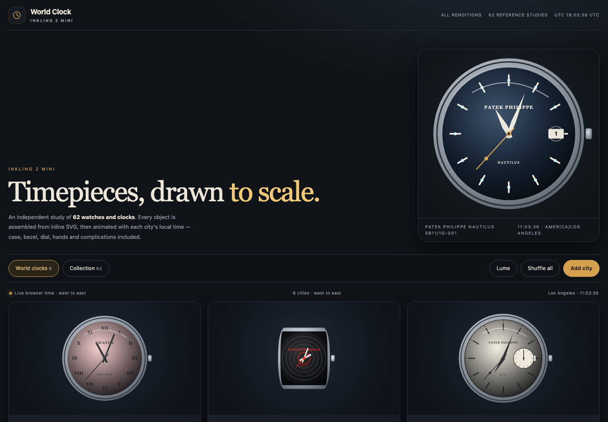
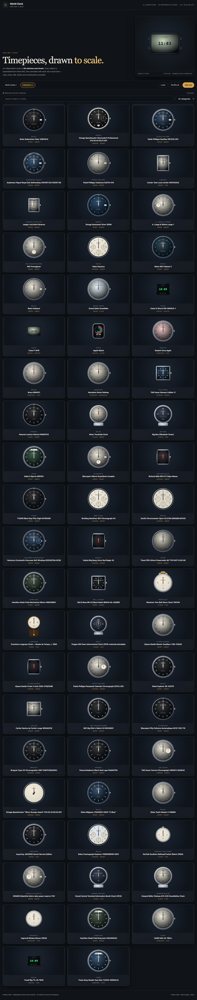
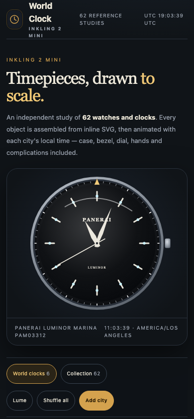

# Inkling 2 Mini reference notes

`versions/inkling-2-mini.html` is a standalone implementation with its own markup, styles, JavaScript, and inline SVG drawings. It does not import or adapt another model rendition.

The supplied watch-photo archive was available during the original authoring work, but this checkpoint did not complete a side-by-side review of all 62 faces. Twenty-seven face folders in the archive were empty. Treat the current drawings as first-pass interpretations, not as verified photographic matches. The archive and its photos are not committed.

## Implementation and approximations

The page contains 62 catalog entries and presents live city clocks, a searchable collection, and interactive inspection controls. The watch and clock artwork is inline SVG; it does not embed raster references. Fine dial printing, exact reference variants, materials, and mechanical details have not been individually verified against photographs in this checkpoint.

The existing Silver Snoopy display label omits “50th Anniversary” from the canonical catalog name. It was left unchanged in accordance with the instruction not to modify the rendition page.

## Rendered proof

