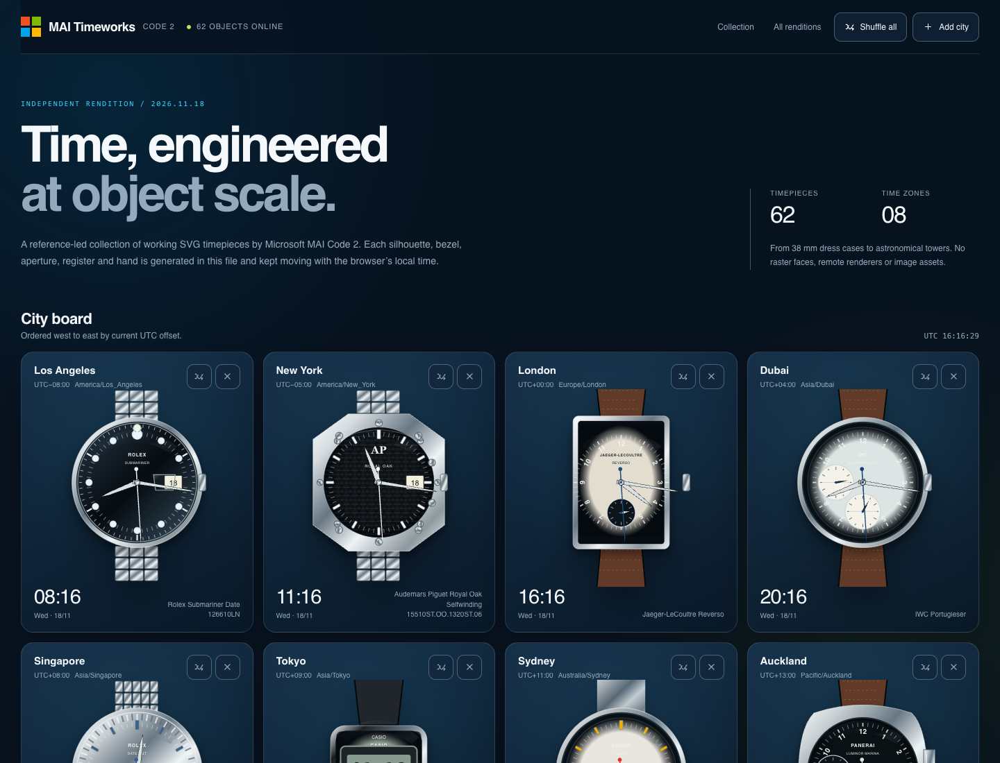
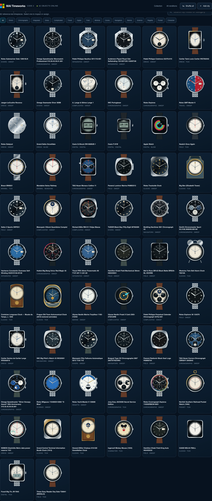

# Microsoft MAI Code 2 reference notes

Microsoft MAI Code 2’s `versions/mai-code-2.html` page is a clean-room standalone implementation. It does not copy, import, or adapt another model page’s HTML, JavaScript, CSS, or SVG artwork.

The supplied `watchpics` archive was used as local visual research. Reference photos are not committed to this repository and no raster watch images are embedded in the page.

## Major fidelity checks

The page gives the visibly different object families their own geometry rather than treating every piece as a round watch:

- The Royal Oak uses an octagonal bezel with eight paired screws and a Grande Tapisserie field.
- The Nautilus uses a rounded octagon, integrated bracelet shoulders, and horizontal blue dial texture.
- Submariner, GMT-Master II, Seamaster, Black Bay, Seiko 5, and Fifty Fathoms use distinct dive-bezel and dial systems.
- Tank, Reverso, Monaco, BR 03, Santos, and the Casio references use rectangular or instrument-specific cases and appropriate numeral placement.
- The Snowflake, Nautilus, Royal Oak, PRX, Milgauss, and rainbow Daytona use face-specific texture, crystal, marker, or color treatments.
- Large complication sets use separately positioned registers, including Speedmaster, Daytona, Navitimer, El Primero, Type XX, Carrera, Silver Snoopy, and the perpetual-calendar chronograph.
- The Freak X rotates an exposed carousel without a normal hand set. The Yacht-Master II includes an adjustable countdown display.
- Digital pieces use live LCD or smart-watch text. Apple Watch and Big Tic retain their object-specific display hierarchy.
- Big Ben, the terminal clocks, alarm clock, astronomical clock, pocket watch, and both longcase clocks receive independent silhouettes and dial centers.

## Interactions and approximations

All 62 inline SVGs run in the standalone browser page. City time comes from `Intl.DateTimeFormat` and IANA time-zone rules; city cards are sorted by current UTC offset west to east. Search, add, remove, individual shuffle, duplicate-aware shuffle-all, collection filtering, enlarged inspection, and fixed-pose controls are implemented locally.

The inspector supports 10:10, 12:00, 03:15, 06:30, 23:59, and an arbitrary minute pose. Chronograph controls animate register hands; the Yacht-Master II can be set to 5, 10, or 15 minutes and started, paused, resumed, or reset.

Some moving astronomy, moon, power-reserve, and historical-clock mechanisms are visual simulations. The page does not claim to reproduce mechanical calibers. Material shading, lume, printed typography, and fine finishing are practical SVG approximations of the supplied references.

## Rendered proof

[Phone view](assets/mai-code-2-mobile.png) · [Yacht-Master II inspection](assets/mai-code-2-inspection.png)
