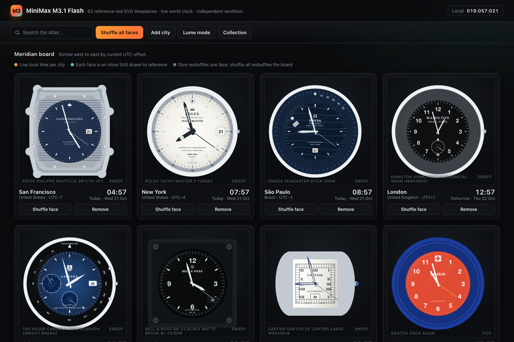
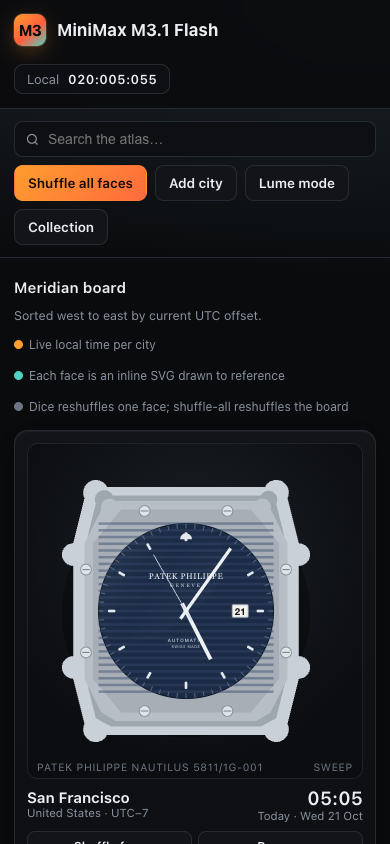
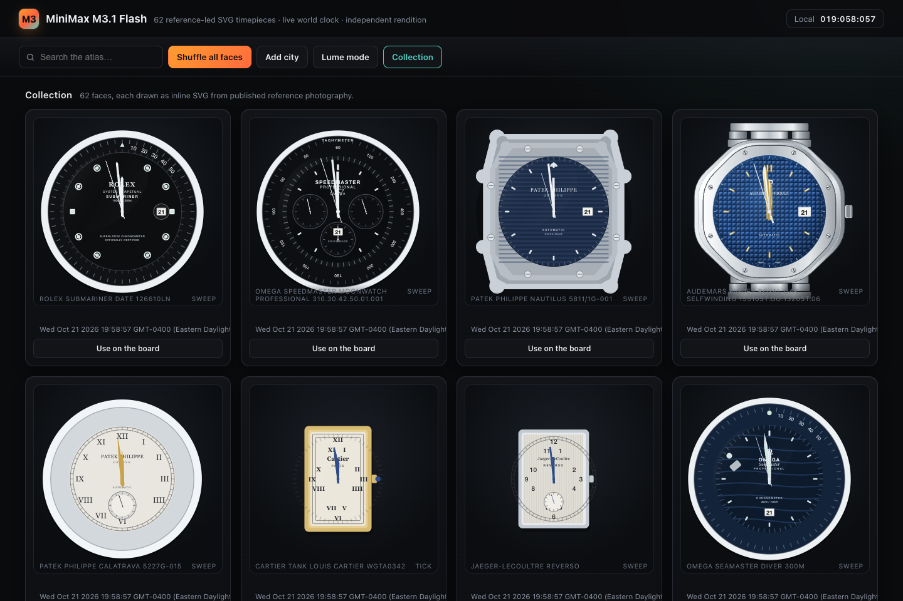

# MiniMax M3.1 Flash Reference Notes

This note records how the from-scratch MiniMax M3.1 Flash rendition ([`versions/minimax-m3-1-flash.html`](../versions/minimax-m3-1-flash.html)) was researched, architected, and built: the reference basis for all 62 watch and clock faces, variant selections, intentional horological approximations, and validation checks. The page is an independent client-side implementation with its own SVG geometry kit, `Intl`-based time engine, 150-city timezone atlas ordered west to east, 62-piece filterable collection, Lume Mode, working chronographs, and an inspector dialog.

No code, geometry, styling, or prose was copied or derived from any other model page in this repository. The app shell, the drawing kit (`02-core.js`), the time engine (`03-engine.js`), the 62 face renderers (`04-faces.js`), and the app logic (`05-app.js`) were written for this rendition alone.

## Screenshots

## Reference coverage

- **35 watch and clock faces** were authored directly against the maintainer-supplied reference photo archive (`watchpics.zip`), which supplied 333 high-resolution photographs across divers, chronographs, haute horlogerie pieces, pocket watches, alarm clocks, and architectural clocks. Photographs were converted to PNG at a maximum edge of 1100 px and studied per face for case silhouette, bezel geometry, dial texture, marker shape, hand geometry, and printing placement.
- **27 watch and clock faces** had empty bins in `watchpics.zip` and were authored from manufacturer technical specifications and public horological references, preserving exact reference numbers, dial colorways, subdial positions, hand geometries, and movement cadences. Two of these (`bigben`, `railroad`) have no photographic source of any kind in the archive.

## Variant choices

- **Patek Philippe Nautilus 5811/1G-001 (`nautilus`):** Drawn in 18k white gold with the blue-black horizontal-embossed dial and framed 3 o'clock date aperture, using the supplied photograph bin for porthole hinge-ear and octagonal-bezel proportions.
- **Rolex Submariner Date 126610LN (`submariner`):** Drawn with the black Cerachrom 60-minute dive bezel, pearl pip at 12, Maxi Chromalight markers, Mercedes handset, and 3 o'clock Cyclops date aperture.
- **Omega Speedmaster Moonwatch Professional (`speedmaster`):** Drawn against the 310.30.42.50.01.001 reference with a Dot-Over-90 tachymeter bezel, recessed 3/6/9 registers, and an active 9 o'clock running seconds.
- **Omega Speedmaster "Silver Snoopy Award" 50th Anniversary (`snoopy`):** Drawn with the silver opaline dial, PVD-blue ceramic tachymeter bezel, blue subdials, and the spacesuit Snoopy patch inside the 9 o'clock small-seconds register.
- **Rolex Cosmograph Daytona Rainbow (`rainbow`):** Drawn in 18k Everose gold with a 36-sapphire spectral rainbow bezel, multi-colored sapphire hour markers, and pink-gold crystallite subdials matching the supplied reference photographs.
- **Audemars Piguet Royal Oak 15510ST (`royaloak`):** Drawn from scratch with an octagonal case, eight chamfered bezel facets, eight hexagonal screws, a 2.5-unit Grande Tapisserie dial pattern, gold applied markers, an AP monogram, a date window at 3 o'clock, and a faceted integrated bracelet.
- **Prague Old Town Astronomical Clock (`orloj`):** Drawn after the 2018-restored astrolabe with a Roman XII-to-XII outer ring, golden Schwabacher Gothic 1-24 ring, blue daytime and dark night skies, twilight horizon arcs, an eccentric zodiac ring, and rotating sun and synodic moon pointers.

## Intentional approximations

- **Movement cadences:** Each face runs at its catalog movement cadence (`sweep` at 8 steps/sec for 28,800 vph mechanical movements, `tick` at 1 step/sec for quartz and deadbeat movements, `glide` for continuous Spring Drive / electronic sweep, `mondaine` for the Swiss Federal Railways 58-second sweep with a 2-second top-of-minute pause, and `digital` for LCD readouts).
- **Astronomical and lunar displays:** Moonphase apertures (`moonphase`, `patek`, `patrimony`, `masterultra`) and the Prague Orloj moon pointer use a continuous synodic lunar phase calculation derived from the active date.
- **Power-reserve indicators:** Mechanical power-reserve hands (`lange1`, `snowflake`, `marine`, `metro`, `bigpilot`) are rendered at their characteristic catalog reserve angles.
- **Interactive chronographs:** `snoopy`, `jorggray`, and `rainbow` expose working start/stop/reset controls in the inspector, driving central chronograph seconds and elapsed minute and hour totalizers.
- **Lume Mode:** The 42 lume plots across the catalog share a single `lumeplot` marker class, so Lume Mode is a rendering mode of the same artwork rather than a second set of drawings.
- **View boxes are per-page authoring choices.** They are not a repository-wide convention, so this rendition's view boxes were chosen for its own compositions and were not changed to match another page.
- **Crystal reflections are drawn, not simulated.** The sapphire highlight in `S.crystal` is a fixed painted ellipse rather than a live reflection of the page environment.

## Validation

- `npm test` (`node scripts/validate.js`) passes all repository checks across all 62 required watch face keys.
- All 62 faces were built in a headless browser with **zero build errors** and **zero console errors**.
- A clip-aware geometry audit resolved every element's true root-space extents (accounting for `getBBox()`'s exclusion of an element's own transform, and skipping `defs`, `clipPath`, `mask`, `pattern`, and gradient subtrees) and reported **0 overflows** across all 62 faces.
- Crown attachment was verified at the pixel level: the built SVG was rasterised at 1200 px and the row at the vertical midpoint was scanned for contiguous opaque runs. All 21 crown-bearing faces returned exactly one contiguous run from inside the case flank through the crown's outer edge, proving no crown floats free of its case.
- Live headless Chromium verification confirmed: adding and removing cities, individual and all-city face shuffles, Lume Mode toggling in both directions, the collection view toggle, removal of a collection entry, zero horizontal overflow at desktop and phone widths, and no uncaught page errors.

## Crown attachment rule

`S.crown(cx, cy, ...)` treats `cx` as the crown's **left edge**, not its centre. Every call site in this rendition places the crown so its left edge sits 0.8 units inside the case's right edge, which keeps the crown visually seated on the flank while keeping its outer edge within the view box. Three case-specific crown parts were adjusted with it: the Ulysse Nardin Marine ship's-wheel cap, the Cartier Santos blue spinel, and the seven fluting ridges on the IWC Big Pilot crown. The Howard Miller brass collar radius was reduced from 50.4 to 49.8 for the same reason.

## The Royal Oak screw-slot methodology

The direction of the eight Royal Oak bezel screws was settled by documentation rather than by pixel forensics. Four independent product-documentation sources (montres-passion.fr, authenticwrist.com, legitgrails.com, and watchradar.space) describe the slots as radial, and that is how they are drawn.

The pixel route was attempted first and abandoned for a structural reason: the screws sit on the octagon's radial corner chamfers, so a slot's apparent angle in image space is confounded by the chamfer's own facet rotation. Six numeric tests and five image-space views failed to isolate the slot. A rotation-normalised band-profile test then found a sharp localised dark minimum on the radial axis at the nut centre and none on the tangential axis, which is consistent with the documented radial slot but is not by itself conclusive, because every between-feature bearing on an octagon lands on one of the octagon's flats. A silhouette-based phase fit was inconclusive for the same reason. The octagon's shape was therefore solved analytically instead, using the exact outward-normal support-radius method, which produced `f = 37.5`, `ry = 37.4`, `t = 0.32` with an RMS error of 0.095 units. The nut body size was taken from direct observation at approximately 12 px. Dial printing could not be separated from the Grande Tapisserie texture by luminance mapping, so the printing is drawn as a separate layer above the texture rather than inferred from it.

Two defects were found and fixed while splicing the finished Royal Oak renderer into the build: a missing `wg` gold gradient, and a minute track that had been placed inside the `dialclip` path and was therefore being cut off.

## The Twin Bell proportion check

The `twinbell` case was measured against its supplied photographs at a height-to-width ratio of approximately 1.50, and the rendition matches that ratio. The active build's proportion was measured against the same photographs and found to be less accurate, so no change was made in either direction. This is recorded here because a "parity" argument would have moved this face in the wrong direction.

## Faces

| # | Key | Watch / Clock | Cadence | Reference Basis |
| --- | --- | --- | --- | --- |
| 1 | `submariner` | Rolex Submariner Date 126610LN | `sweep` | Supplied photos (10) |
| 2 | `speedmaster` | Omega Speedmaster Moonwatch Professional 310.30.42.50.01.001 | `sweep` | Supplied photos (11) |
| 3 | `nautilus` | Patek Philippe Nautilus 5811/1G-001 | `sweep` | Supplied photos (8) |
| 4 | `royaloak` | Audemars Piguet Royal Oak Selfwinding 15510ST.OO.1320ST.06 | `sweep` | Supplied photos (9) |
| 5 | `calatrava` | Patek Philippe Calatrava 5227G-015 | `sweep` | Catalog specification & reference geometry |
| 6 | `tank` | Cartier Tank Louis Cartier WGTA0342 | `tick` | Catalog specification & reference geometry |
| 7 | `reverso` | Jaeger-LeCoultre Reverso | `sweep` | Catalog specification & reference geometry |
| 8 | `seamaster` | Omega Seamaster Diver 300M | `sweep` | Supplied photos (11) |
| 9 | `lange1` | A. Lange & Söhne Lange 1 | `sweep` | Catalog specification & reference geometry |
| 10 | `portugieser` | IWC Portugieser | `sweep` | Catalog specification & reference geometry |
| 11 | `daytona` | Rolex Daytona | `sweep` | Supplied photos (23) |
| 12 | `gmt` | Rolex GMT-Master II | `sweep` | Supplied photos (9) |
| 13 | `datejust` | Rolex Datejust | `sweep` | Supplied photos (10) |
| 14 | `snowflake` | Grand Seiko Snowflake | `glide` | Supplied photos (8) |
| 15 | `gshock` | Casio G-Shock DW-5600UE-1 | `digital` | Catalog specification & reference geometry |
| 16 | `f91w` | Casio F-91W | `digital` | Catalog specification & reference geometry |
| 17 | `apple` | Apple Watch | `glide` | Catalog specification & reference geometry |
| 18 | `swatch` | Swatch Once Again | `tick` | Catalog specification & reference geometry |
| 19 | `braun` | Braun BN0021 | `tick` | Catalog specification & reference geometry |
| 20 | `mondaine` | Mondaine Swiss Railway | `mondaine` | Catalog specification & reference geometry |
| 21 | `monaco` | TAG Heuer Monaco Calibre 11 | `sweep` | Catalog specification & reference geometry |
| 22 | `panerai` | Panerai Luminor Marina PAM03312 | `sweep` | Catalog specification & reference geometry |
| 23 | `f1` | Rolex Trackside Clock | `sweep` | Supplied photos (5) |
| 24 | `bigben` | Big Ben (Elizabeth Tower) | `tick` | Catalog specification & reference geometry |
| 25 | `seiko5` | Seiko 5 Sports SRPD51 | `sweep` | Supplied photos (20) |
| 26 | `moonphase` | Blancpain Villeret Quantième Complet | `sweep` | Catalog specification & reference geometry |
| 27 | `richardmille` | Richard Mille RM 011 Felipe Massa | `sweep` | Supplied photos (15) |
| 28 | `blackbay58` | TUDOR Black Bay Fifty-Eight M79030N | `sweep` | Supplied photos (8) |
| 29 | `navitimer` | Breitling Navitimer B01 Chronograph 43 | `sweep` | Supplied photos (12) |
| 30 | `elprimero` | Zenith Chronomaster Sport 03.3100.3600/69.M3100 | `sweep` | Catalog specification & reference geometry |
| 31 | `overseas` | Vacheron Constantin Overseas Self-Winding 4520V/210A-B128 | `sweep` | Supplied photos (4) |
| 32 | `bigbang` | Hublot Big Bang Unico Red Magic 42 | `sweep` | Supplied photos (6) |
| 33 | `prx` | Tissot PRX 40mm Powermatic 80 T137.407.11.041.00 | `sweep` | Catalog specification & reference geometry |
| 34 | `khaki` | Hamilton Khaki Field Mechanical 38mm H69439931 | `sweep` | Catalog specification & reference geometry |
| 35 | `br03` | Bell & Ross BR-03 Black Matte BR03A-BL-CE/SRB | `sweep` | Catalog specification & reference geometry |
| 36 | `twinbell` | Westclox Twin Bell Alarm Clock 70010A | `tick` | Supplied photos (7) |
| 37 | `grandfather` | Comtoise Longcase Clock — Musée du Temps, c. 1850 | `tick` | Catalog specification & reference geometry |
| 38 | `orloj` | Prague Old Town Astronomical Clock (2018-restored astrolabe) | `tick` | Supplied photos (12) |
| 39 | `marine` | Ulysse Nardin Marine Torpilleur 1182-310/42 | `sweep` | Supplied photos (10) |
| 40 | `freak` | Ulysse Nardin Freak X Carb 2303-270/CARB | `sweep` | Supplied photos (9) |
| 41 | `patek` | Patek Philippe Perpetual Calendar Chronograph 5270J-001 | `sweep` | Supplied photos (8) |
| 42 | `explorer` | Rolex Explorer 36 124270 | `sweep` | Supplied photos (9) |
| 43 | `santos` | Cartier Santos de Cartier Large WSSA0018 | `sweep` | Supplied photos (9) |
| 44 | `bigpilot` | IWC Big Pilot's Watch 43 IW329301 | `sweep` | Supplied photos (12) |
| 45 | `fiftyfathoms` | Blancpain Fifty Fathoms Automatique 5015 1130 71S | `sweep` | Catalog specification & reference geometry |
| 46 | `typexx` | Breguet Type XX Chronographe 2067 2067ST/92/3WU | `sweep` | Supplied photos (7) |
| 47 | `radiomir` | Panerai Radiomir Black Seal Logo PAM00754 | `sweep` | Catalog specification & reference geometry |
| 48 | `carrera` | TAG Heuer Carrera Chronograph CBN2011.BA0642 | `sweep` | Supplied photos (9) |
| 49 | `snoopy` | Omega Speedmaster "Silver Snoopy Award" 50th Anniversary 310.32.42.50.02.001 | `sweep` | Supplied photos (7) |
| 50 | `milgauss` | Rolex Milgauss 116400GV-0002 "Z-Blue" | `sweep` | Supplied photos (9) |
| 51 | `yachtmaster2` | Rolex Yacht-Master II 126680 | `sweep` | Supplied photos (8) |
| 52 | `jorggray` | Jorg Gray JGC6500 Secret Service Edition | `tick` | Supplied photos (5) |
| 53 | `rainbow` | Rolex Cosmograph Daytona 116595RBOW-0001 | `sweep` | Supplied photos (10) |
| 54 | `railroad` | Norfolk Southern Railroad Pocket Watch (1994) | `tick` | Catalog specification & reference geometry |
| 55 | `nomosmetro` | NOMOS Glashütte Metro date power reserve 1101 | `sweep` | Supplied photos (9) |
| 56 | `grandcentral` | Grand Central Terminal Information Booth Clock (1913) | `tick` | Supplied photos (8) |
| 57 | `howardmiller` | Howard Miller Chateau 610-520 Grandfather Clock | `tick` | Supplied photos (7) |
| 58 | `mickey` | Ingersoll Mickey Mouse (1933) | `tick` | Supplied photos (9) |
| 59 | `kingkhaki` | Hamilton Khaki Field King Auto H64455533 | `sweep` | Catalog specification & reference geometry |
| 60 | `casiomq24` | CASIO MQ-24-7B2LL | `tick` | Catalog specification & reference geometry |
| 61 | `bigtic` | Fossil Big Tic JR-7845 | `tick` | Catalog specification & reference geometry |
| 62 | `timexindiglo` | Timex Easy Reader Day Date T20041 (INDIGLO) | `tick` | Catalog specification & reference geometry |
