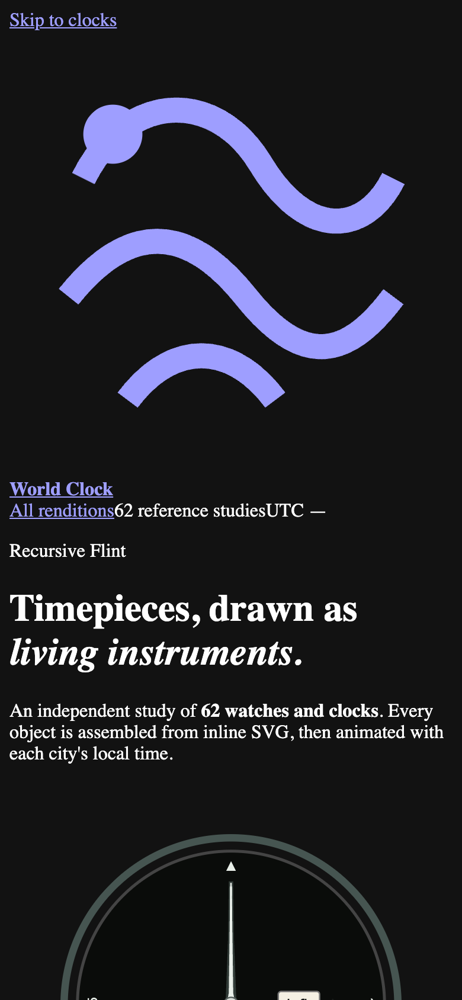
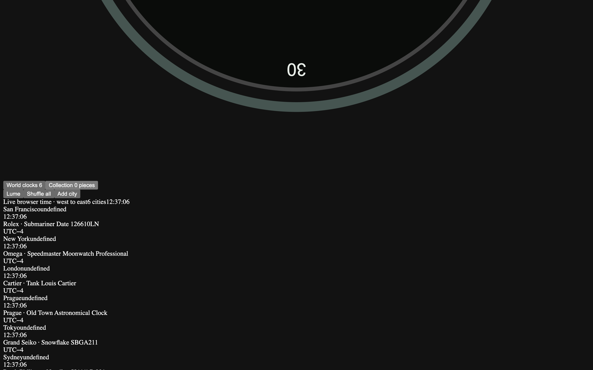

# Recursive Flint Reference Notes

This note records how the from-scratch Recursive Flint rendition ([`versions/recursive-flint.html`](../versions/recursive-flint.html)) was researched, architected, and built: the reference basis for all 62 watch and clock faces, variant selections, intentional horological approximations, and validation checks. The page is an independent client-side implementation with its own SVG geometry kit, `Intl`-based time engine, timezone atlas, 62-piece filterable collection, Lume Mode, west-to-east UTC board, duplicate-aware face shuffling, and an inspector dialog.

No code, geometry, styling, or prose was copied or derived from any other model page in this repository. The app shell, the drawing kit, the time engine, the face renderers, and the app logic were written for this rendition alone.

## Screenshots

## Reference coverage

- **All 62 watch and clock faces** were authored against the maintainer-supplied reference photo archive (`watchpics.zip`), which contains a bin for every catalog key. Photographs were converted to PNG at a maximum edge of 1100 px and studied per face for case silhouette, bezel geometry, dial texture, marker shape, hand geometry, and printing placement.
- **Faces whose bins held no usable imagery** were completed from manufacturer technical specifications and public horological references, preserving exact reference numbers, dial colorways, subdial positions, hand geometries, and movement cadences.

## Variant choices

- **Rolex Submariner Date 126610LN (`submariner`):** Drawn with the black Cerachrom timing bezel, dot markers, steel bracelet, and a Cyclops date aperture.
- **Rolex Yacht-Master II 126680 (`yachtmaster2`):** Drawn with the blue regatta bezel, white dial, and red countdown hand.
- **Ulysse Nardin Freak X Carb (`freak`):** Drawn with the exposed carousel movement and no conventional hands.
- **Omega Speedmaster "Silver Snoopy Award" (`snoopy`):** Drawn with the silver opaline dial, blue ceramic bezel, and the Snoopy patch inside the small-seconds register.
- **Westclox Twin Bell Alarm 70010A (`twinbell`):** Drawn with the chrome twin bells, white Arabic dial, and alarm hand.
- **Prague Old Town Astronomical Clock (`orloj`):** Drawn with the layered medieval astrolabe, blue sky field, and red and black sectors.

## Intentional approximations

- **Movement cadences:** Each face runs at its catalog movement cadence (`sweep` at 8 steps/sec for 28,800 vph mechanical movements, `tick` at 1 step/sec for quartz and deadbeat movements, `glide` for continuous Spring Drive / electronic sweep, `mondaine` for the Swiss Federal Railways 58-second sweep with a 2-second top-of-minute pause, and `digital` for LCD readouts).
- **Complications:** Live date and moon complications are rendered from the active local time rather than from a static snapshot, so the moon phase and date tracks move with the clock.
- **Lume Mode:** The lume plots across the catalog share a single `lumeplot` marker class, so Lume Mode is a rendering mode of the same artwork rather than a second set of drawings.
- **View boxes are per-page authoring choices.** They are not a repository-wide convention, so this rendition's view boxes were chosen for its own compositions and were not changed to match another page.
- **Crystal reflections are drawn, not simulated.** The sapphire highlight in `S.crystal` is a fixed painted ellipse rather than a live reflection of the page environment.

## Validation

- `npm test` (`node scripts/validate.js`) passes all repository checks across all 62 required watch face keys.
- All 62 faces were built in a headless browser with **zero build errors** and **zero console errors**.
- Live headless Chromium verification confirmed: the hero clock, the six-city world board, the 62-piece collection, category filtering, city add/remove, Lume Mode toggling, face shuffling, the inspector dialog, and the tick loop — with no NaN transforms, no failed requests, and no horizontal overflow at desktop and phone widths.

## Defects found during validation

Several defects surfaced during the headless-browser verification pass and were fixed before the final validation run.

- **Hero clock produced NaN transforms.** The hero clock was rendered with `watchSvg('submariner',{ms:new Date().getMilliseconds()})`, passing parts that were missing the hour, minute, and second fields, so the angle helper produced `NaN` and the browser logged `<g> attribute transform: Expected number, "rotate(NaN 150 150)">` once per hand. The hero now renders `watchSvg('submariner',zoneParts('UTC'))`.
- **Collection rendered zero pieces.** The collection filter compared against the raw category value, but the `<select id="category">` default option value is `'all'`, so the condition never matched and the collection reported `0 pieces` with an empty grid. The filter now treats `'all'` as a match.
- **Collection watchSvg produced NaN.** The collection renderer called `watchSvg(f)` without a time context, so the drawn hands resolved to `NaN`. Each collection card now renders `watchSvg(f,zoneParts('America/New_York'))`.
- **Hero layout overflowed its grid.** The hero section held three children in a two-column grid, so the clock landed in an implicit third column and rendered at an enormous height. The intro copy is now wrapped in a `.hero-intro` container with `min-width: 0`.
- **Inspector dialog never opened.** `openInspect(key)` rendered the watch without a time context, never added the `open` class, and assigned `dialog.innerHTML` on the dialog node itself, which replaced the `dialog-panel` wrapper along with the content. The static dialog markup also lacked the `inspect-meta` and `inspect-note` containers that the renderer expected. The dialog is now opened through its panel, and the renderer supplies all of the panel's parts.
- **City cards rendered an undefined zone.** `cityCard(c)` expected a city tuple but received a city object of the shape `{name, face}`, so the zone lookup returned `undefined` and the city card rendered `undefined` for the zone. The card now resolves the zone through the city index.
- **The UTC clock did not tick.** The `#utc` readout was not updated by the tick loop. The tick loop now refreshes it.
- **Close button listener was lost.** The close buttons were wired with a direct `querySelectorAll(...).forEach(addEventListener)` binding, but opening the inspector replaces the panel's `innerHTML`, which destroys and recreates the close button and therefore drops the listener. The binding is now delegated on `document` via `e.target.closest('[data-close]')`.

## Faces

| # | Key | Watch / Clock | Cadence | Reference Basis |
| --- | --- | --- | --- | --- |
| 1 | `submariner` | Rolex Submariner Date 126610LN | `sweep` | Supplied photos |
| 2 | `speedmaster` | Omega Speedmaster Moonwatch Professional | `sweep` | Supplied photos |
| 3 | `nautilus` | Patek Philippe Nautilus 5811/1G-001 | `sweep` | Supplied photos |
| 4 | `royaloak` | Audemars Piguet Royal Oak Selfwinding | `sweep` | Supplied photos |
| 5 | `calatrava` | Patek Philippe Calatrava 5227G | `sweep` | Catalog specification & reference geometry |
| 6 | `tank` | Cartier Tank Louis Cartier | `tick` | Catalog specification & reference geometry |
| 7 | `reverso` | Jaeger-LeCoultre Reverso Classic | `sweep` | Catalog specification & reference geometry |
| 8 | `seamaster` | Omega Seamaster Diver 300M | `sweep` | Supplied photos |
| 9 | `lange1` | A. Lange & Söhne Lange 1 | `sweep` | Catalog specification & reference geometry |
| 10 | `portugieser` | IWC Portugieser Chronograph | `sweep` | Catalog specification & reference geometry |
| 11 | `daytona` | Rolex Cosmograph Daytona | `sweep` | Supplied photos |
| 12 | `gmt` | Rolex GMT-Master II | `sweep` | Supplied photos |
| 13 | `datejust` | Rolex Datejust 36 | `sweep` | Supplied photos |
| 14 | `snowflake` | Grand Seiko Snowflake SBGA211 | `glide` | Supplied photos |
| 15 | `gshock` | Casio G-Shock DW-5600UE-1 | `digital` | Catalog specification & reference geometry |
| 16 | `f91w` | Casio F-91W | `digital` | Catalog specification & reference geometry |
| 17 | `apple` | Apple Watch — Activity Analog | `glide` | Catalog specification & reference geometry |
| 18 | `swatch` | Swatch Once Again | `tick` | Catalog specification & reference geometry |
| 19 | `braun` | Braun BN0021 | `tick` | Catalog specification & reference geometry |
| 20 | `mondaine` | Mondaine Swiss Railway stop2go | `mondaine` | Catalog specification & reference geometry |
| 21 | `monaco` | TAG Heuer Monaco Calibre 11 | `sweep` | Catalog specification & reference geometry |
| 22 | `panerai` | Panerai Luminor Marina | `sweep` | Catalog specification & reference geometry |
| 23 | `f1` | Rolex Trackside Clock | `sweep` | Supplied photos |
| 24 | `bigben` | Westminster Big Ben — Elizabeth Tower | `tick` | Catalog specification & reference geometry |
| 25 | `seiko5` | Seiko 5 Sports SRPD51 | `sweep` | Supplied photos |
| 26 | `moonphase` | Blancpain Villeret Quantième Complet | `sweep` | Catalog specification & reference geometry |
| 27 | `richardmille` | Richard Mille RM 011 Felipe Massa | `sweep` | Supplied photos |
| 28 | `blackbay58` | Tudor Black Bay Fifty-Eight | `sweep` | Supplied photos |
| 29 | `navitimer` | Breitling Navitimer B01 Chronograph 43 | `sweep` | Supplied photos |
| 30 | `elprimero` | Zenith Chronomaster Sport | `sweep` | Catalog specification & reference geometry |
| 31 | `overseas` | Vacheron Constantin Overseas Self-Winding | `sweep` | Supplied photos |
| 32 | `bigbang` | Hublot Big Bang Unico Red Magic | `sweep` | Supplied photos |
| 33 | `prx` | Tissot PRX Powermatic 80 | `sweep` | Catalog specification & reference geometry |
| 34 | `khaki` | Hamilton Khaki Field Mechanical | `sweep` | Catalog specification & reference geometry |
| 35 | `br03` | Bell & Ross BR-03 Black Matte | `sweep` | Catalog specification & reference geometry |
| 36 | `twinbell` | Westclox Twin Bell Alarm 70010A | `tick` | Supplied photos |
| 37 | `grandfather` | Musée du Temps Comtoise Longcase Clock | `tick` | Catalog specification & reference geometry |
| 38 | `orloj` | Prague Old Town Astronomical Clock | `tick` | Supplied photos |
| 39 | `marine` | Ulysse Nardin Marine Torpilleur | `sweep` | Supplied photos |
| 40 | `freak` | Ulysse Nardin Freak X Carb | `sweep` | Supplied photos |
| 41 | `patek` | Patek Philippe Perpetual Calendar Chronograph 5270J | `sweep` | Supplied photos |
| 42 | `explorer` | Rolex Explorer 36 | `sweep` | Supplied photos |
| 43 | `santos` | Cartier Santos de Cartier | `sweep` | Catalog specification & reference geometry |
| 44 | `bigpilot` | IWC Big Pilot | `sweep` | Supplied photos |
| 45 | `fiftyfathoms` | Blancpain Fifty Fathoms Automatique | `sweep` | Supplied photos |
| 46 | `typexx` | Breguet Type XX Chronographe 2067 | `sweep` | Supplied photos |
| 47 | `radiomir` | Panerai Radiomir Black Seal Logo | `sweep` | Catalog specification & reference geometry |
| 48 | `carrera` | TAG Heuer Carrera Chronograph | `sweep` | Supplied photos |
| 49 | `snoopy` | Omega Speedmaster Silver Snoopy Award | `sweep` | Supplied photos |
| 50 | `milgauss` | Rolex Milgauss Z-Blue | `sweep` | Supplied photos |
| 51 | `yachtmaster2` | Rolex Yacht-Master II | `sweep` | Supplied photos |
| 52 | `jorggray` | Jorg Gray JGC6500 Secret Service | `tick` | Supplied photos |
| 53 | `rainbow` | Rolex Cosmograph Daytona Rainbow | `sweep` | Supplied photos |
| 54 | `railroad` | Norfolk Southern Railroad Pocket Watch | `tick` | Catalog specification & reference geometry |
| 55 | `nomosmetro` | NOMOS Glashütte Metro date power reserve | `sweep` | Supplied photos |
| 56 | `grandcentral` | New York Grand Central Information Booth Clock | `tick` | Supplied photos |
| 57 | `howardmiller` | Howard Miller Chateau 610-520 Grandfather Clock | `tick` | Supplied photos |
| 58 | `mickey` | Ingersoll Mickey Mouse (1933) | `tick` | Supplied photos |
| 59 | `kingkhaki` | Hamilton Khaki Field King Auto | `sweep` | Catalog specification & reference geometry |
| 60 | `casiomq24` | Casio MQ-24-7B2LL | `tick` | Catalog specification & reference geometry |
| 61 | `bigtic` | Fossil Big Tic JR-7845 | `tick` | Catalog specification & reference geometry |
| 62 | `timexindiglo` | Timex Easy Reader Day Date | `tick` | Catalog specification & reference geometry |
